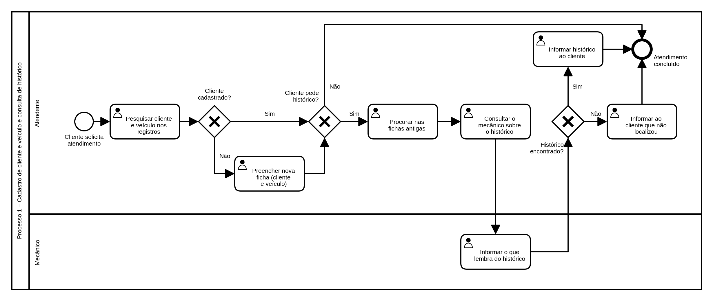
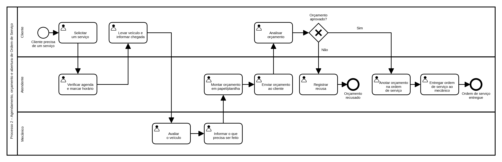
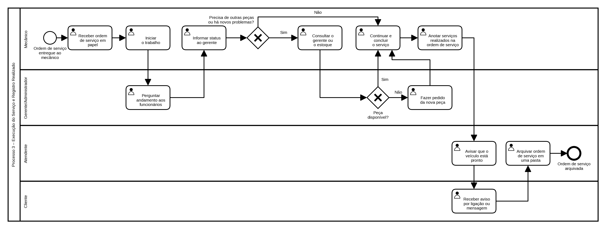
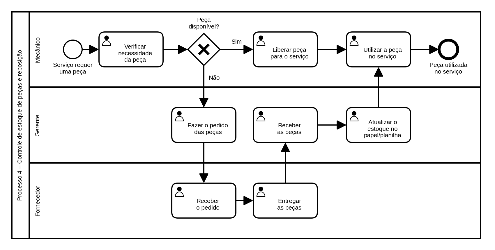
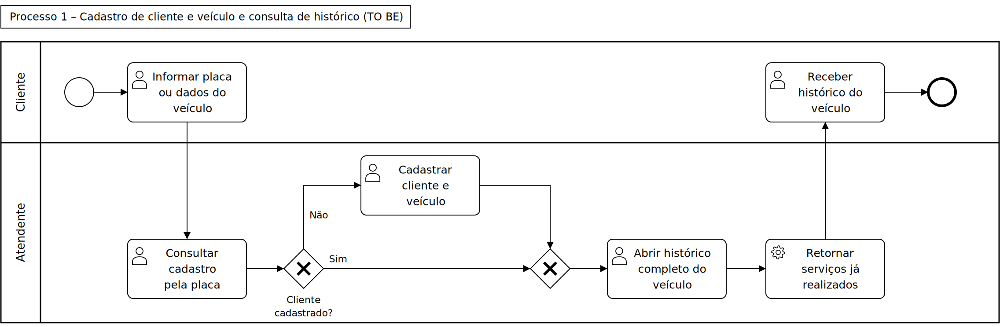
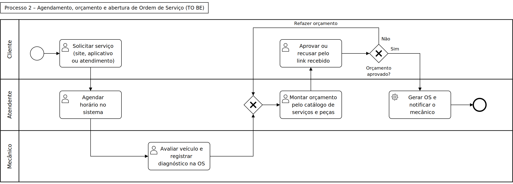
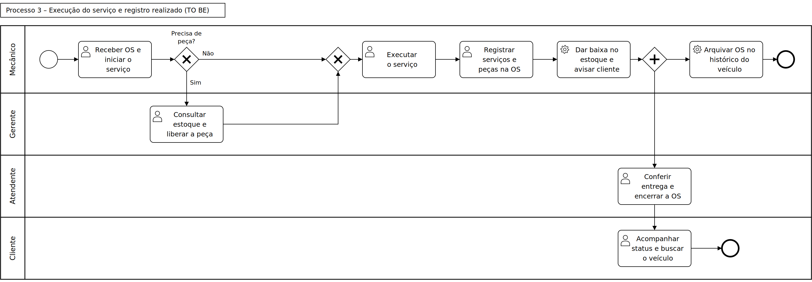
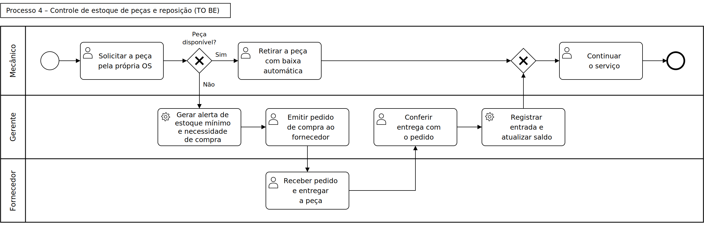

## 3. Modelagem dos Processos de Negócio

Os processos que constituem este projeto são: Cadastro de clientes/veículos, gestão de estoque, orçamento, agendamento e ordem de serviço.

O processo inicial é o de cadastro do cliente e dos veículos, necessário para conduzir todos os outros processos, uma vez que aqui se tem como entrada todas as informações do cliente e o veículo/os veículos atrelados a ele, além de um histórico dos serviços já realizados, suas datas, orçamentos e quaisquer outras informações relevantes. Tais informações são usadas como parte da entrada dos processos seguintes.
Em seguida, temos a gestão de estoque, processo fundamental para manter o controle de uma oficina, tendo em vista que praticamente todos os serviços dependem do uso de diversos produtos e é necessário que se mantenha o estoque em dia, com uma quantidade mínima de cada recurso. As entradas serão atualizações constantes sobre entrada/saída e quantidades de cada produto, enquanto as saídas serão alertas quando atingir o valor mínimo de um determinado produto, além da quantidade que será usada em um determinado serviço.
O 3º processo de negócio se trata do orçamento, uma vez que solicitado um serviço, o cliente precisa concordar com os valores e autorizar que o serviço seja agendado e realizado. Aqui, a entrada são os valores de produtos, mão de obra, tempo de serviço e entre outros que o estabelecimento julgar necessários, cuja soma resulta na saída do orçamento completo.
O processo de agendamento será utilizado para organizar o calendário da oficina, sem que haja conflito de agendas, horários, serviços e prestadores de serviços. Nesta etapa, teremos como entrada as informações do cliente/veículo, além de data inicial e data final prevista, horário e serviço solicitado, e a saída sendo o agendamento em si, marcado para a oficina e enviado ao cliente.

Por fim, após o cliente aceitar o orçamento e realizar o agendamento, é criada uma ordem de serviço, com o intuito de melhor organizar a oficina e os serviços, para que não haja erros, atrasos ou sobrecarga de algum funcionário, fazer a conferência de produto que serão necessários e se há estoque dos mesmos. As entradas são os dados do cliente e do veículo, relatório de estoque, possível descrição do serviço solicitado e há qual funcionário será destinado.

### 3.1. Modelagem da situação atual (Modelagem AS IS)

Atualmente, os processos de uma oficina mecânica podem ser realizados de forma manual, utilizando cadernos, fichas, papéis, planilhas e outros meios de comunicação. Dessa forma, as informações sobre clientes, veículos, serviços e peças podem ficar distribuídas em diferentes locais, dificultando o acesso e o acompanhamento das atividades.

Para representar a situação atual da oficina, foram escolhidos quatro processos relacionados às principais atividades do negócio: cadastro de clientes e veículos e consulta de histórico; agendamento, orçamento e abertura de ordem de serviço; execução do serviço e registro dos serviços realizados; e controle de estoque de peças e reposição. A seguir, são apresentados os processos da forma como são realizados atualmente.

**Processo 1 – Cadastro de cliente e veículo e consulta de histórico**

O processo começa quando o cliente chega à oficina ou entra em contato e informa os dados do veículo. A atendente verifica em cadernos, fichas ou planilhas se o cliente já possui um cadastro. Caso não esteja cadastrado, é necessário preencher uma nova ficha com as informações do cliente e do veículo.

Quando o cliente precisa consultar informações sobre alguma manutenção ou serviço realizado anteriormente, a atendente procura os registros antigos. Caso não encontre o histórico nas fichas ou planilhas, é necessário consultar o mecânico para verificar se ele possui alguma informação sobre o serviço realizado.

**Processo 2 – Agendamento, orçamento e abertura de Ordem de Serviço**

O processo começa quando o cliente solicita um serviço para seu veículo e informa o problema ou a necessidade de manutenção. A atendente verifica a agenda da oficina e marca um horário para o atendimento.

Após o veículo chegar à oficina, o mecânico realiza uma avaliação e informa quais serviços precisam ser realizados. Com essas informações, a atendente monta o orçamento utilizando papel ou planilha e envia as informações para o cliente analisar.

Caso o cliente aprove o orçamento, a atendente registra as informações na ordem de serviço e entrega o documento ao mecânico para que o serviço possa ser realizado. Caso o orçamento não seja aprovado, a recusa do cliente é registrada e o processo é encerrado.

**Processo 3 – Execução do serviço e registro realizado**

Após receber a ordem de serviço em papel, o mecânico inicia o trabalho no veículo. Durante a execução, podem surgir necessidades de outras peças ou novos problemas no veículo. Nesses casos, o mecânico informa a situação ao gerente ou responsável e verifica se a peça necessária está disponível.

Quando a peça está disponível, ela é liberada para utilização e o mecânico continua o serviço. Após finalizar o trabalho, os serviços realizados são anotados na própria ordem de serviço.

Depois disso, a atendente avisa o cliente que o veículo está pronto, por ligação ou mensagem. A ordem de serviço é então arquivada em uma pasta para que possa ser consultada posteriormente.

**Processo 4 – Controle de estoque de peças e reposição**

Durante a execução de um serviço, o mecânico verifica quais peças são necessárias e consulta se elas estão disponíveis no estoque. Caso a peça esteja disponível, ela é liberada para o serviço e utilizada no veículo.

Quando a peça necessária não está disponível, o gerente realiza um pedido ao fornecedor. O fornecedor recebe o pedido e posteriormente entrega as peças solicitadas à oficina.

Após receber as peças, o gerente atualiza o controle de estoque utilizando papel ou planilha. Dessa forma, o controle da entrada e saída de peças depende do registro manual das informações.

### 3.2. Descrição geral da proposta (Modelagem TO BE)

Tendo identificado os gargalos dos modelos AS IS, apresentem uma descrição da proposta de solução, buscando maior eficiência com a introdução da tecnologia. Abordem também os limites dessa solução e o seu alinhamento com as estratégias e objetivos do contexto de negócio escolhido.
Colem aqui os modelos da solução proposta (modelo TO BE) elaborados com o apoio da ferramenta baseada em BPMN utilizada na disciplina.
Cada processo identificado deve ter seu modelo TO-BE específico. Descrevam as oportunidades de melhoria de cada processo da solução proposta.

_Apresente aqui uma descrição da sua proposta abordando seus limites e suas ligações com as estratégias e objetivos do negócio. Apresente aqui as oportunidades de melhorias._### 3.2. Descrição geral da proposta (Modelagem TO BE)

A análise dos processos atuais mostrou que os principais gargalos da oficina estão na forma como as informações são registradas e consultadas. Os dados de clientes, veículos, orçamentos, ordens de serviço e peças ficam espalhados em cadernos, fichas, planilhas e na memória dos funcionários. Por causa disso, o mesmo cliente pode ser cadastrado mais de uma vez, o histórico de um veículo nem sempre é encontrado, o orçamento precisa ser montado manualmente a cada atendimento, a ordem de serviço em papel pode ser perdida e o controle de estoque só é atualizado depois que a peça já foi utilizada.

A proposta é a implantação de um sistema web com banco de dados único, reunindo o cadastro de clientes e veículos, o agendamento, o orçamento, a ordem de serviço e o controle de estoque. Os quatro processos passam a utilizar a mesma base de dados, de modo que a informação registrada em uma etapa fica disponível para as etapas seguintes sem precisar ser digitada novamente.

Com o sistema, o cliente e o veículo são cadastrados uma única vez e o histórico de serviços fica ligado à placa do veículo. A agenda eletrônica mostra os horários disponíveis dos mecânicos, o orçamento é montado a partir de um catálogo de serviços e peças já cadastrados e a ordem de serviço é gerada automaticamente quando o cliente aprova o orçamento. O sistema também passa a realizar tarefas que hoje são manuais, como dar baixa das peças no estoque, avisar o cliente quando o serviço termina, arquivar a ordem de serviço no histórico do veículo e emitir alerta quando o saldo de uma peça atinge a quantidade mínima.

A solução proposta também possui limites. O sistema não substitui o diagnóstico técnico do mecânico e não automatiza a execução do serviço, apenas organiza e registra as informações relacionadas a ele. O pedido ao fornecedor continua sendo feito pelo gerente, já que não está prevista a integração automática com os sistemas dos fornecedores. Nesta versão também não estão incluídos o módulo financeiro completo e a emissão de documentos fiscais. Além disso, a qualidade das informações depende do preenchimento correto pela equipe, o sistema exige conexão com a internet e um dispositivo disponível na área de serviço, e a implantação envolve custo de treinamento e um período de transição em que os registros antigos em papel precisam ser migrados.

A proposta está alinhada aos objetivos do negócio em três pontos. No atendimento, o acesso imediato ao histórico do veículo e a agilidade na elaboração do orçamento reduzem o tempo de espera do cliente. Na operação, o fim do retrabalho de cadastro e o controle de estoque atualizado reduzem as paradas de serviço por falta de peça e o tempo gasto procurando informações. Na gestão, a base centralizada permite que o gerente acompanhe informações que hoje não existem de forma organizada, como os serviços mais realizados, a quantidade de orçamentos aprovados e o giro das peças em estoque.

A seguir, são apresentados os processos da forma como passam a ser realizados com a solução proposta.

**Processo 1 – Cadastro de cliente e veículo e consulta de histórico**

O processo começa quando o cliente informa a placa ou os dados do veículo. A atendente consulta o cadastro diretamente no sistema e, caso o veículo ainda não esteja registrado, realiza o cadastro do cliente e do veículo na mesma tela. O sistema verifica os dados informados e impede que o mesmo cliente seja cadastrado novamente.

Com o cadastro localizado, a atendente abre o histórico do veículo e o sistema retorna todos os serviços já realizados. Dessa forma, o cliente é informado durante o próprio atendimento, sem a necessidade de procurar fichas antigas ou perguntar ao mecânico se ele lembra do serviço.

As oportunidades de melhoria deste processo são o cadastro único por placa, que evita duplicidade e dados incompletos, o histórico centralizado em banco de dados, que deixa de depender de papéis e da memória dos funcionários, e a possibilidade de o próprio cliente consultar as informações do veículo pelo portal de autoatendimento.

**Processo 2 – Agendamento, orçamento e abertura de Ordem de Serviço**

O processo começa quando o cliente solicita o serviço pelo site, pelo aplicativo ou pelo atendimento da oficina. A atendente realiza o agendamento no sistema, que mostra apenas os horários realmente disponíveis.

Quando o veículo chega à oficina, o mecânico avalia o veículo e registra o diagnóstico na própria ordem de serviço, em vez de informar verbalmente à atendente. Com essas informações, a atendente monta o orçamento utilizando o catálogo de serviços e peças já cadastrados e o sistema envia o documento ao cliente por link.

Caso o cliente aprove o orçamento, o sistema gera a ordem de serviço automaticamente e notifica o mecânico. Caso o orçamento não seja aprovado, a atendente refaz o orçamento no sistema e o cliente analisa a nova proposta, ficando registrado o motivo da recusa.

As oportunidades de melhoria deste processo são a agenda eletrônica com disponibilidade real, que evita horários em conflito e agendamentos esquecidos, o registro do diagnóstico pelo mecânico, que elimina as informações incompletas repassadas verbalmente, e a aprovação formal do orçamento com data e status gravados, que encerra o vai e volta em conversas e permite abrir a ordem de serviço sem redigitar os dados.

**Processo 3 – Execução do serviço e registro realizado**

O mecânico recebe a ordem de serviço no sistema e inicia o trabalho no veículo. Quando surge a necessidade de outra peça, a solicitação é registrada na própria ordem de serviço e o gerente consulta o estoque em tempo real para liberar a peça.

Após finalizar o trabalho, o mecânico registra no sistema os serviços executados e as peças utilizadas. O sistema dá baixa das peças no estoque, avisa o cliente automaticamente e arquiva a ordem de serviço no histórico digital do veículo. A atendente confere a entrega e encerra a ordem de serviço, enquanto o cliente acompanha o status e busca o veículo.

As oportunidades de melhoria deste processo são a ordem de serviço eletrônica com controle de status, que elimina o risco de perda do papel e o registro resumido do que foi feito, a solicitação de peça pela própria ordem de serviço, com consulta imediata ao estoque, e o aviso automático ao cliente, que passa a acompanhar o andamento sem depender de uma ligação.

**Processo 4 – Controle de estoque de peças e reposição**

Durante a execução de um serviço, o mecânico solicita a peça pela própria ordem de serviço. Caso a peça esteja disponível, ele retira o item e o sistema realiza a baixa automática no estoque, permitindo que o serviço continue.

Quando a peça não está disponível, o sistema gera o alerta de estoque mínimo e a necessidade de compra. O gerente emite o pedido ao fornecedor, que recebe a solicitação e entrega as peças à oficina. Após a entrega, o gerente confere as peças com o pedido e o sistema registra a entrada e atualiza o saldo, liberando a peça para o serviço que estava aguardando.

As oportunidades de melhoria deste processo são a baixa automática no momento do uso, que faz o saldo registrado no sistema ficar igual ao saldo real da prateleira, o alerta de estoque mínimo, que antecipa a compra e evita a parada do serviço por falta de peça, e o registro dos pedidos e das entradas, que cria um histórico organizado de fornecedores, prazos e preços.

### 3.3. Modelagem dos processos

[PROCESSO 1 - Cadastro de clientes/veículos](./processos/processo-1-cadastro-clientes-veiculos.md "Detalhamento do Processo 1.")

[PROCESSO 2 - Cadastro de estoque](./processos/processo-2-cadastro-de-estoque.md "Detalhamento do Processo 2.")

[PROCESSO 3 - Pesquisar Produto](./processos/processo-3-consulta-ao-estoque.md "Detalhamento do Processo 3.")

[PROCESSO 4 - Orçamento](./processos/processo-4-Orçamento.md "Detalhamento do Processo 4.")
