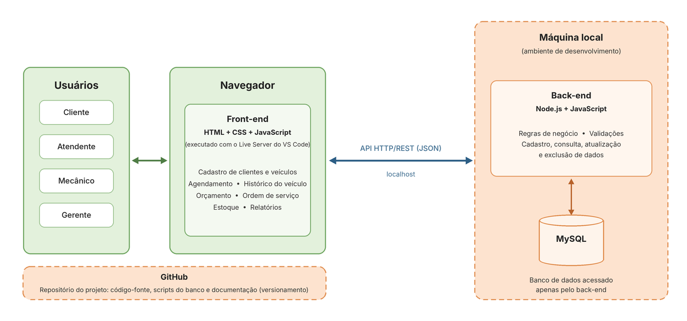
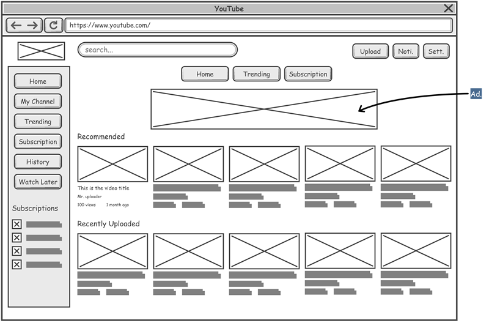
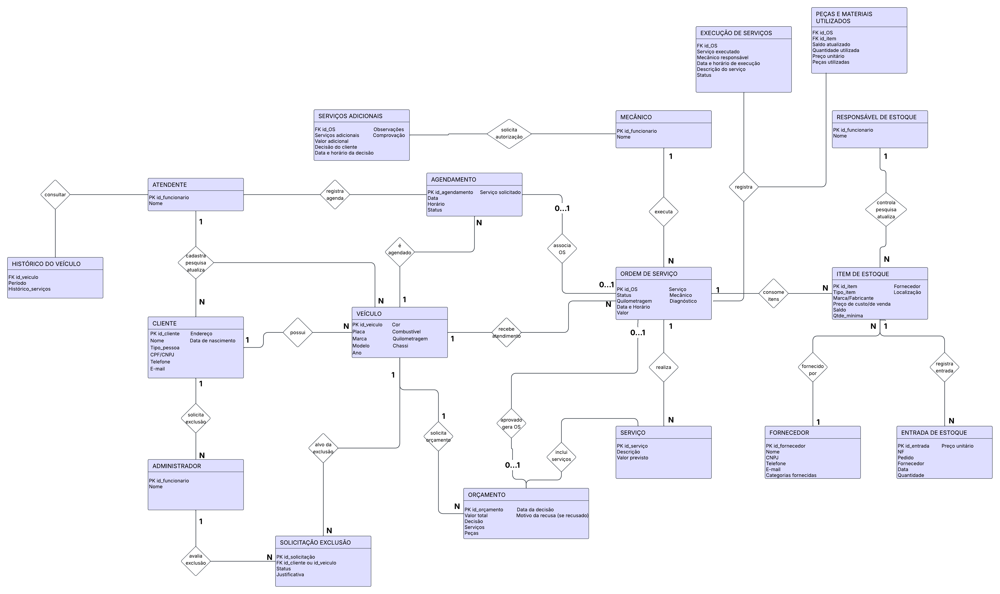
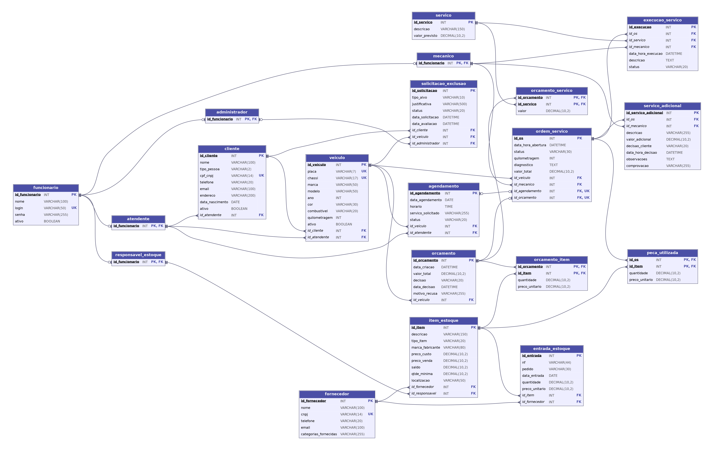
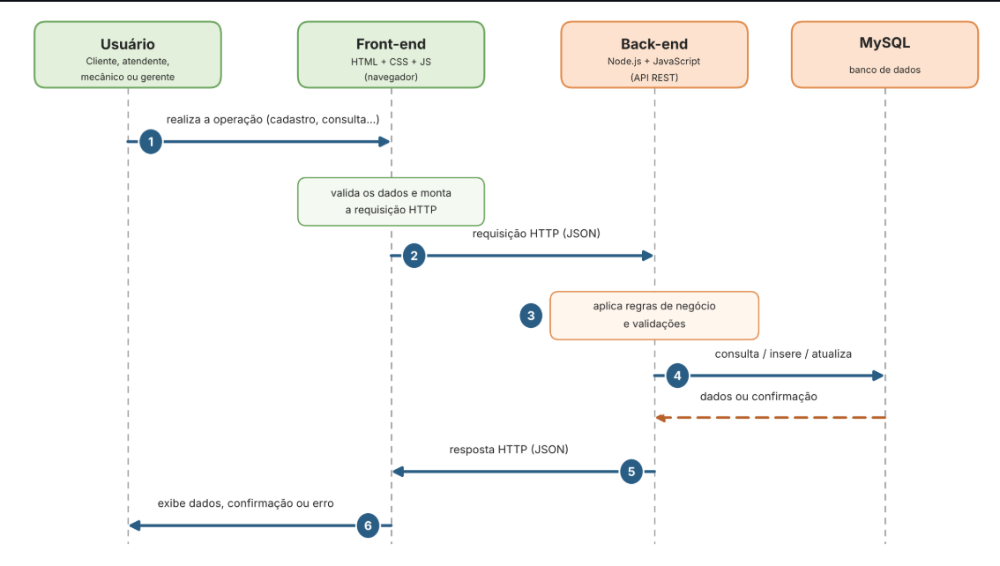

## 4. Projeto da Solução

Pré-requisitos: <a href="03-Modelagem do Processo de Negocio.md"> Modelagem do Processo de Negocio</a>

## 4.1. Arquitetura da solução

A solução proposta para o projeto consiste no desenvolvimento de um sistema web para auxiliar no gerenciamento dos processos de uma oficina mecânica. O sistema tem como objetivo centralizar as informações de clientes, veículos, agendamentos, orçamentos, ordens de serviço e estoque de peças, facilitando o acesso aos dados e melhorando a organização das atividades da oficina.

A arquitetura da solução segue o modelo cliente-servidor, dividindo o sistema em camadas responsáveis pela interface com o usuário, pelo processamento das regras de negócio e pelo armazenamento das informações. Essa organização facilita a manutenção, a evolução e a integração dos diferentes módulos do sistema.
 
 **Diagrama de Arquitetura**:
 
 

A arquitetura é composta pelos seguintes módulos:

- **Front-end:** responsável pela interface com os usuários, permitindo a utilização das funcionalidades do sistema por meio de um navegador web. Será desenvolvido com HTML, CSS e JavaScript e executado localmente com a extensão Live Server do Visual Studio Code, contemplando telas de cadastro de clientes e veículos, agendamento, histórico do veículo, orçamento, ordem de serviço, estoque e relatórios.

- **Back-end:** responsável pelo processamento das requisições e pela aplicação das regras de negócio. Será desenvolvido em JavaScript com Node.js, centralizando as operações de cadastro, consulta, atualização e exclusão de dados, além das validações necessárias.

- **Banco de dados:** responsável pelo armazenamento persistente das informações do sistema. Será utilizado o MySQL para organizar os dados de clientes, veículos, usuários, agendamentos, serviços, orçamentos, ordens de serviço, peças e movimentações de estoque. O banco será acessado pelo back-end, evitando que o navegador se comunique diretamente com ele.

- **Execução e repositório:** o sistema não será publicado: ele é executado localmente, na máquina de desenvolvimento. O front-end é aberto no navegador pelo Live Server, o back-end em Node.js é executado localmente e o banco MySQL é instalado na própria máquina. O GitHub é utilizado para armazenar e versionar o código-fonte, os scripts do banco de dados e a documentação do projeto.

- **Usuários:** o sistema atenderá aos perfis de atendente, mecânico e gerente, cada um utilizando as funcionalidades relacionadas às suas responsabilidades.

O funcionamento da arquitetura ocorre da seguinte forma: o usuário acessa o sistema pelo navegador e realiza uma operação, como cadastrar um veículo, consultar o histórico de serviços ou agendar um atendimento. O front-end envia a requisição HTTP ao back-end, que também é executado na máquina local (localhost). O servidor processa a solicitação, verifica as regras de negócio e, quando necessário, consulta ou atualiza os dados no MySQL. 

Dessa forma, a separação entre interface, regras de negócio e armazenamento contribui para a organização do código, a integridade das informações e a manutenção do sistema. A centralização dos dados também permite que diferentes módulos utilizem as mesmas informações, reduzindo a duplicidade de registros e o retrabalho nos processos da oficina.
 

### 4.2. Protótipos de telas

Visão geral da interação do usuário pelas telas do sistema e protótipo interativo das telas com as funcionalidades que fazem parte do sistema (wireframes).
Apresente as principais interfaces da plataforma. Discuta como ela foi elaborada de forma a atender os requisitos funcionais, não funcionais e histórias de usuário abordados nas <a href="02-Especificação do Projeto.md"> Especificação do Projeto</a>.
A partir das atividades de usuário identificadas na seção anterior, elabore o protótipo de tela de cada uma delas.

São protótipos usados em design de interface para sugerir a estrutura de um site web e seu relacionamentos entre suas páginas. Um wireframe web é uma ilustração semelhante do layout de elementos fundamentais na interface.
 
> **Links Úteis**:
> - [Protótipos vs Wireframes](https://www.nngroup.com/videos/prototypes-vs-wireframes-ux-projects/)
> - [Ferramentas de Wireframes](https://rockcontent.com/blog/wireframes/)
> - [MarvelApp](https://marvelapp.com/developers/documentation/tutorials/)
> - [Figma](https://www.figma.com/)
> - [Adobe XD](https://www.adobe.com/br/products/xd.html#scroll)
> - [Axure](https://www.axure.com/edu) (Licença Educacional)
> - [InvisionApp](https://www.invisionapp.com/) (Licença Educacional)

## Diagrama de Classes

O diagrama de classes ilustra graficamente como será a estrutura do software, e como cada uma das classes da sua estrutura estarão interligadas. Essas classes servem de modelo para materializar os objetos que executarão na memória.

As referências abaixo irão auxiliá-lo na geração do artefato “Diagrama de Classes”.

> - [Diagramas de Classes - Documentação da IBM](https://www.ibm.com/docs/pt-br/rational-soft-arch/9.6.1?topic=diagrams-class)
> - [O que é um diagrama de classe UML? | Lucidchart](https://www.lucidchart.com/pages/pt/o-que-e-diagrama-de-classe-uml)

## Modelo ER

O Modelo ER representa através de um diagrama como as entidades (coisas, objetos) se relacionam entre si na aplicação interativa.

As referências abaixo irão auxiliá-lo na geração do artefato “Modelo ER”.

> - [Como fazer um diagrama entidade relacionamento | Lucidchart](https://www.lucidchart.com/pages/pt/como-fazer-um-diagrama-entidade-relacionamento)

### 4.3. Modelo de dados

O desenvolvimento da solução proposta requer a existência de bases de dados que permitam efetuar os cadastros de dados e controles associados aos processos identificados, assim como recuperações.
Utilizando a notação do DER (Diagrama Entidade e Relacionamento), elaborem um modelo, na ferramenta visual indicada na disciplina, que contemple todas as entidades e atributos associados às atividades dos processos identificados. Deve ser gerado um único DER que suporte todos os processos escolhidos, visando, assim, uma base de dados integrada. O modelo deve contemplar, também, o controle de acesso de usuários (partes interessadas dos processos) de acordo com os papéis definidos nos modelos do processo de negócio.
_Apresente o modelo de dados por meio de um modelo relacional que contemple todos os conceitos e atributos apresentados na modelagem dos processos._

#### 4.3.1 Modelo ER

#### 4.3.2 Esquema Relacional

---

#### 4.3.3 Modelo Físico

CREATE DATABASE oficina_mecanica;
USE oficina_mecanica;

CREATE TABLE funcionario (
    id_funcionario INT PRIMARY KEY AUTO_INCREMENT,
    nome VARCHAR(100) NOT NULL,
    login VARCHAR(50) NOT NULL UNIQUE,
    senha VARCHAR(255) NOT NULL,
    ativo BOOLEAN DEFAULT TRUE
);

CREATE TABLE atendente (
    id_funcionario INT PRIMARY KEY,
    FOREIGN KEY (id_funcionario) REFERENCES funcionario(id_funcionario)
);

CREATE TABLE mecanico (
    id_funcionario INT PRIMARY KEY,
    FOREIGN KEY (id_funcionario) REFERENCES funcionario(id_funcionario)
);

CREATE TABLE administrador (
    id_funcionario INT PRIMARY KEY,
    FOREIGN KEY (id_funcionario) REFERENCES funcionario(id_funcionario)
);

CREATE TABLE responsavel_estoque (
    id_funcionario INT PRIMARY KEY,
    FOREIGN KEY (id_funcionario) REFERENCES funcionario(id_funcionario)
);

CREATE TABLE cliente (
    id_cliente INT PRIMARY KEY AUTO_INCREMENT,
    nome VARCHAR(100) NOT NULL,
    tipo_pessoa VARCHAR(2) NOT NULL,
    cpf_cnpj VARCHAR(14) NOT NULL UNIQUE,
    telefone VARCHAR(20) NOT NULL,
    email VARCHAR(100),
    endereco VARCHAR(200),
    data_nascimento DATE,
    ativo BOOLEAN DEFAULT TRUE,
    id_atendente INT NOT NULL,
    FOREIGN KEY (id_atendente) REFERENCES atendente(id_funcionario)
);

CREATE TABLE veiculo (
    id_veiculo INT PRIMARY KEY AUTO_INCREMENT,
    placa VARCHAR(7) NOT NULL UNIQUE,
    chassi VARCHAR(17) UNIQUE,
    marca VARCHAR(50) NOT NULL,
    modelo VARCHAR(50) NOT NULL,
    ano INT NOT NULL,
    cor VARCHAR(30),
    combustivel VARCHAR(20),
    quilometragem INT,
    ativo BOOLEAN DEFAULT TRUE,
    id_cliente INT NOT NULL,
    id_atendente INT NOT NULL,
    FOREIGN KEY (id_cliente) REFERENCES cliente(id_cliente),
    FOREIGN KEY (id_atendente) REFERENCES atendente(id_funcionario)
);

CREATE TABLE agendamento (
    id_agendamento INT PRIMARY KEY AUTO_INCREMENT,
    data_agendamento DATE NOT NULL,
    horario TIME NOT NULL,
    servico_solicitado VARCHAR(255) NOT NULL,
    status VARCHAR(20) DEFAULT 'AGENDADO',
    id_veiculo INT NOT NULL,
    id_atendente INT NOT NULL,
    FOREIGN KEY (id_veiculo) REFERENCES veiculo(id_veiculo),
    FOREIGN KEY (id_atendente) REFERENCES atendente(id_funcionario)
);

CREATE TABLE servico (
    id_servico INT PRIMARY KEY AUTO_INCREMENT,
    descricao VARCHAR(150) NOT NULL,
    valor_previsto DECIMAL(10,2) NOT NULL
);

CREATE TABLE fornecedor (
    id_fornecedor INT PRIMARY KEY AUTO_INCREMENT,
    nome VARCHAR(100) NOT NULL,
    cnpj VARCHAR(14) NOT NULL UNIQUE,
    telefone VARCHAR(20),
    email VARCHAR(100),
    categorias_fornecidas VARCHAR(255)
);

CREATE TABLE item_estoque (
    id_item INT PRIMARY KEY AUTO_INCREMENT,
    descricao VARCHAR(150) NOT NULL,
    tipo_item VARCHAR(20) NOT NULL,
    marca_fabricante VARCHAR(80),
    preco_custo DECIMAL(10,2) NOT NULL,
    preco_venda DECIMAL(10,2) NOT NULL,
    saldo DECIMAL(10,2) DEFAULT 0,
    qtde_minima DECIMAL(10,2) DEFAULT 0,
    localizacao VARCHAR(50),
    id_fornecedor INT NOT NULL,
    id_responsavel INT NOT NULL,
    FOREIGN KEY (id_fornecedor) REFERENCES fornecedor(id_fornecedor),
    FOREIGN KEY (id_responsavel) REFERENCES responsavel_estoque(id_funcionario)
);

CREATE TABLE entrada_estoque (
    id_entrada INT PRIMARY KEY AUTO_INCREMENT,
    nf VARCHAR(44) NOT NULL,
    pedido VARCHAR(30),
    data_entrada DATE NOT NULL,
    quantidade DECIMAL(10,2) NOT NULL,
    preco_unitario DECIMAL(10,2) NOT NULL,
    id_item INT NOT NULL,
    id_fornecedor INT NOT NULL,
    FOREIGN KEY (id_item) REFERENCES item_estoque(id_item),
    FOREIGN KEY (id_fornecedor) REFERENCES fornecedor(id_fornecedor)
);

CREATE TABLE orcamento (
    id_orcamento INT PRIMARY KEY AUTO_INCREMENT,
    data_criacao DATETIME DEFAULT CURRENT_TIMESTAMP,
    valor_total DECIMAL(10,2) DEFAULT 0,
    decisao VARCHAR(20) DEFAULT 'PENDENTE',
    data_decisao DATETIME,
    motivo_recusa VARCHAR(255),
    id_veiculo INT NOT NULL,
    FOREIGN KEY (id_veiculo) REFERENCES veiculo(id_veiculo)
);

CREATE TABLE orcamento_servico (
    id_orcamento INT,
    id_servico INT,
    valor DECIMAL(10,2) NOT NULL,
    PRIMARY KEY (id_orcamento, id_servico),
    FOREIGN KEY (id_orcamento) REFERENCES orcamento(id_orcamento),
    FOREIGN KEY (id_servico) REFERENCES servico(id_servico)
);

CREATE TABLE orcamento_item (
    id_orcamento INT,
    id_item INT,
    quantidade DECIMAL(10,2) NOT NULL,
    preco_unitario DECIMAL(10,2) NOT NULL,
    PRIMARY KEY (id_orcamento, id_item),
    FOREIGN KEY (id_orcamento) REFERENCES orcamento(id_orcamento),
    FOREIGN KEY (id_item) REFERENCES item_estoque(id_item)
);

CREATE TABLE ordem_servico (
    id_os INT PRIMARY KEY AUTO_INCREMENT,
    data_hora_abertura DATETIME DEFAULT CURRENT_TIMESTAMP,
    status VARCHAR(30) DEFAULT 'ABERTA',
    quilometragem INT,
    diagnostico TEXT,
    valor_total DECIMAL(10,2) DEFAULT 0,
    id_veiculo INT NOT NULL,
    id_mecanico INT NOT NULL,
    id_agendamento INT UNIQUE,
    id_orcamento INT UNIQUE,
    FOREIGN KEY (id_veiculo) REFERENCES veiculo(id_veiculo),
    FOREIGN KEY (id_mecanico) REFERENCES mecanico(id_funcionario),
    FOREIGN KEY (id_agendamento) REFERENCES agendamento(id_agendamento),
    FOREIGN KEY (id_orcamento) REFERENCES orcamento(id_orcamento)
);

CREATE TABLE execucao_servico (
    id_execucao INT PRIMARY KEY AUTO_INCREMENT,
    id_os INT NOT NULL,
    id_servico INT NOT NULL,
    id_mecanico INT NOT NULL,
    data_hora_execucao DATETIME,
    descricao TEXT,
    status VARCHAR(20) DEFAULT 'PENDENTE',
    FOREIGN KEY (id_os) REFERENCES ordem_servico(id_os),
    FOREIGN KEY (id_servico) REFERENCES servico(id_servico),
    FOREIGN KEY (id_mecanico) REFERENCES mecanico(id_funcionario)
);

CREATE TABLE servico_adicional (
    id_servico_adicional INT PRIMARY KEY AUTO_INCREMENT,
    id_os INT NOT NULL,
    id_mecanico INT NOT NULL,
    descricao VARCHAR(255) NOT NULL,
    valor_adicional DECIMAL(10,2) NOT NULL,
    decisao_cliente VARCHAR(20) DEFAULT 'PENDENTE',
    data_hora_decisao DATETIME,
    observacoes TEXT,
    comprovacao VARCHAR(255),
    FOREIGN KEY (id_os) REFERENCES ordem_servico(id_os),
    FOREIGN KEY (id_mecanico) REFERENCES mecanico(id_funcionario)
);

CREATE TABLE peca_utilizada (
    id_os INT,
    id_item INT,
    quantidade DECIMAL(10,2) NOT NULL,
    preco_unitario DECIMAL(10,2) NOT NULL,
    PRIMARY KEY (id_os, id_item),
    FOREIGN KEY (id_os) REFERENCES ordem_servico(id_os),
    FOREIGN KEY (id_item) REFERENCES item_estoque(id_item)
);

CREATE TABLE solicitacao_exclusao (
    id_solicitacao INT PRIMARY KEY AUTO_INCREMENT,
    tipo_alvo VARCHAR(10) NOT NULL,
    justificativa VARCHAR(500) NOT NULL,
    status VARCHAR(20) DEFAULT 'PENDENTE',
    data_solicitacao DATETIME DEFAULT CURRENT_TIMESTAMP,
    data_avaliacao DATETIME,
    id_cliente INT NOT NULL,
    id_veiculo INT,
    id_administrador INT,
    FOREIGN KEY (id_cliente) REFERENCES cliente(id_cliente),
    FOREIGN KEY (id_veiculo) REFERENCES veiculo(id_veiculo),
    FOREIGN KEY (id_administrador) REFERENCES administrador(id_funcionario)
);

CREATE VIEW vw_historico_veiculo AS
SELECT v.id_veiculo, v.placa, os.id_os, os.data_hora_abertura, os.quilometragem,
       os.diagnostico, s.descricao AS servico, es.data_hora_execucao,
       f.nome AS mecanico, os.valor_total
FROM veiculo v
JOIN ordem_servico os ON os.id_veiculo = v.id_veiculo
LEFT JOIN execucao_servico es ON es.id_os = os.id_os
LEFT JOIN servico s ON s.id_servico = es.id_servico
LEFT JOIN funcionario f ON f.id_funcionario = es.id_mecanico;

Link do script na pasta de db:[criacao_db.sql](../src/db/criacao_db.sql).

### 4.4. Tecnologias

Para implementar a solução proposta, serão utilizadas tecnologias voltadas ao desenvolvimento de aplicações web, ao processamento das regras de negócio, ao armazenamento de dados e à execução do sistema. A escolha dessas tecnologias considera a necessidade de desenvolver uma aplicação organizada, de fácil manutenção e capaz de integrar os processos de uma oficina mecânica.

| Dimensão | Tecnologia | Descrição |
|---|---|---|
| SGBD | MySQL | Sistema gerenciador de banco de dados relacional utilizado para armazenar e organizar as informações de clientes, veículos, usuários, agendamentos, orçamentos, ordens de serviço, peças e movimentações de estoque. |
| Front-end | HTML5, CSS3 e JavaScript | Tecnologias utilizadas para construir as páginas web, definir a apresentação visual e implementar interações e validações no navegador. |
| Back-end | JavaScript com Node.js | Tecnologia responsável pela implementação das regras de negócio, pelo processamento das requisições, pelas validações e pela comunicação com o banco de dados. |
| Comunicação entre camadas | API HTTP/REST | Interface de comunicação entre o front-end e o back-end, permitindo enviar requisições e receber respostas em formatos como JSON. |
| Execução do front-end | Live Server (extensão do VS Code) | Extensão que serve localmente as páginas HTML, CSS e JavaScript, permitindo abrir o sistema no navegador durante o desenvolvimento e a demonstração. |
| Execução do back-end | Node.js (ambiente local) | Ambiente em que a aplicação é executada na máquina local, disponibilizando a API para o front-end por meio de localhost. |
| Versionamento e documentação | Git e GitHub | Ferramentas utilizadas para controlar versões e organizar o trabalho em equipe. O repositório armazena a documentação, o código-fonte e os scripts do banco de dados; o sistema não é publicado, sendo executado localmente. |
| IDE de desenvolvimento | Visual Studio Code | Editor utilizado pela equipe para escrever e organizar o código-fonte e a documentação, com extensões para JavaScript e Node.js. |
| Prototipação de telas | Figma | Ferramenta de design utilizada para criar os protótipos e wireframes das telas do sistema |
| Diagramas | Lucidchart | Ferramenta utilizada para elaborar diagramas do projeto, como o modelo ER e o diagrama de classes. |

O processamento de uma requisição no sistema ocorre por meio da interação entre o usuário, o front-end, o back-end e o banco de dados. Esse fluxo permite que as operações realizadas na interface sejam processadas e que seus resultados sejam apresentados ao usuário.

O fluxo de uma requisição pode ser descrito nas seguintes etapas:

1. **Interação do usuário:** o usuário acessa o sistema pelo navegador e realiza uma operação, como cadastrar um cliente, agendar um atendimento, consultar o histórico de um veículo ou registrar uma ordem de serviço.

2. **Processamento no front-end:** as páginas desenvolvidas em HTML, CSS e JavaScript apresentam a interface e realizam as validações necessárias. Quando a operação exige acesso aos dados ou processamento no servidor, o front-end envia uma requisição HTTP para a API do sistema.

3. **Recebimento pelo back-end:** a aplicação desenvolvida em JavaScript com Node.js recebe a requisição, identifica a operação solicitada e executa as validações e regras de negócio correspondentes.

4. **Acesso ao banco de dados:** quando necessário, o back-end consulta, insere, atualiza ou remove informações no banco MySQL. Por exemplo, ao registrar uma ordem de serviço, o sistema pode consultar os dados do cliente e do veículo e registrar os serviços e as peças associados à operação.

5. **Retorno da resposta:** após concluir o processamento, o back-end retorna uma resposta HTTP ao front-end, informando o resultado da operação. Em caso de sucesso, a resposta pode conter os dados solicitados ou a confirmação do registro. Em caso de erro, poderá apresentar uma mensagem adequada.

6. **Exibição do resultado:** o front-end interpreta a resposta recebida e atualiza a interface, exibindo os dados, a confirmação ou a mensagem de erro para o usuário.

Esse fluxo é utilizado nas diferentes funcionalidades, respeitando as particularidades de cada processo. Dessa maneira, a interface fica responsável pela interação com o usuário, o back-end concentra as regras de negócio e o banco de dados mantém as informações persistidas e organizadas.