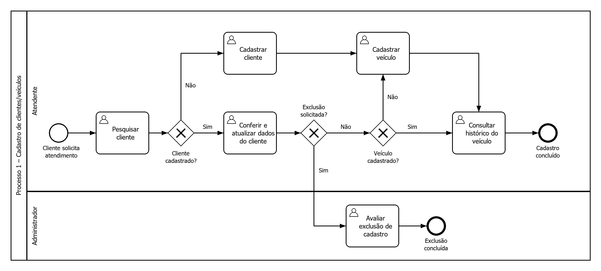
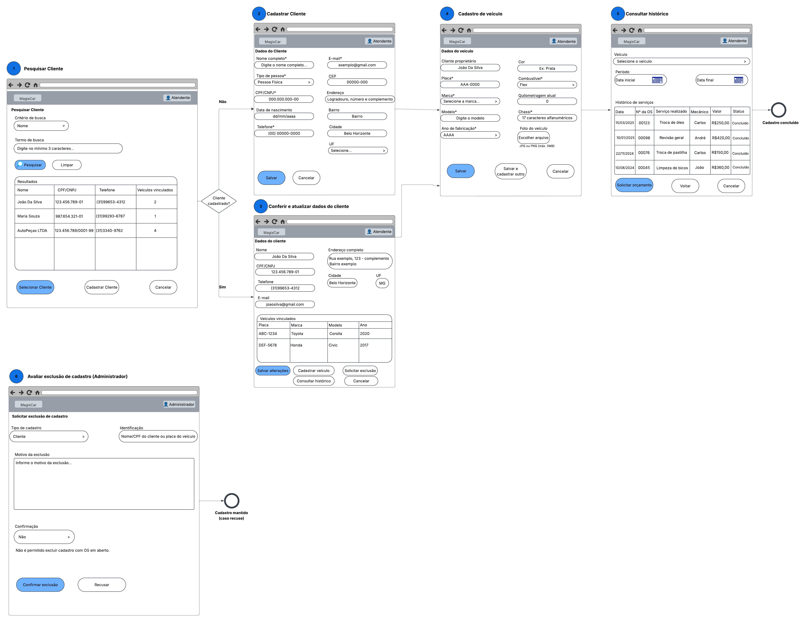

### 3.3.1 Processo 1 – Cadastro de clientes/veículos

O processo de cadastro de clientes e veículos é o processo inicial do sistema MagisCar e serve de base para todos os demais (orçamento, agendamento e ordem de serviço). Ele acontece no balcão de atendimento da oficina mecânica, presencialmente ou a partir de um contato do cliente (telefone ou mensagem), e é executado no sistema web pelo **Atendente**, com a participação do **Cliente**, que fornece seus dados pessoais e os dados do(s) seu(s) veículo(s).

O processo começa quando um cliente procura a oficina solicitando um serviço para o seu veículo e é finalizado quando ambos estão cadastrados e atualizados no sistema.

**Tarefas:**

1. **Pesquisar cliente:** o atendente pesquisa o cliente no sistema por nome, CPF/CNPJ, telefone ou placa do veículo (RF-003);
2. **Cadastrar cliente:** se o cliente **não** estiver cadastrado, o atendente informa os dados fornecidos pelo cliente e realiza o cadastro (RF-001);
3. **Conferir e atualizar dados do cliente:** se o cliente já estiver cadastrado, o atendente confere os dados e, caso necessário, os atualiza (RF-002);
4. **Cadastrar veículo:** com o cliente identificado, o atendente verifica se o veículo que será atendido já está vinculado a ele e, caso não esteja, cadastra o veículo, obrigatoriamente vinculado ao cliente (RF-001 e Restrição 05);
5. **Consultar histórico do veículo:** o atendente consulta os serviços, datas e valores já registrados para o veículo, que podem ser usados para orientar o atendimento e o diagnóstico do mecânico (RF-013);
6. **Avaliar exclusão de cadastro:** caso seja solicitada a exclusão de um cadastro (cliente ou veículo), o administrador avalia o pedido e confirma ou recusa a exclusão (RF-002 e Restrição 07).

**Produtos do processo:** cadastro do cliente, cadastro do(s) veículo(s) vinculado(s) ao cliente e histórico do veículo disponível para consulta.

##### 3.3.1.1 Modelagem BPMN

##### 3.3.1.2 Detalhamento das atividades do usuário (user tasks)

#### Detalhamento das atividades

**1. Pesquisar cliente**

| **Campo**          | **Tipo**        | **Restrições**                                         | **Valor default** |
| ---                | ---             | ---                                                    | ---               |
| Critério de busca  | Seleção única   | Nome, CPF/CNPJ, Telefone, Placa do veículo             | Nome              |
| Termo de busca     | Caixa de texto  | Obrigatório; mínimo de 3 caracteres                    |                   |
| Resultados         | Tabela          | Colunas: Nome, CPF/CNPJ, Telefone, Veículos vinculados; somente leitura |  |

| **Comandos**           | **Destino**                                | **Tipo**  |
| ---                    | ---                                        | ---       |
| Pesquisar              | Pesquisar cliente (exibe resultados)       | default   |
| Selecionar cliente     | Conferir e atualizar dados do cliente      |           |
| Cadastrar novo cliente | Cadastrar cliente                          |           |
| Cancelar               | Fim do Processo 1                          | cancel    |

**2. Cadastrar cliente**

| **Campo**          | **Tipo**        | **Restrições**                                          | **Valor default** |
| ---                | ---             | ---                                                     | ---               |
| Nome completo      | Caixa de texto  | Obrigatório; máximo de 100 caracteres                   |                   |
| Tipo de pessoa     | Seleção única   | Pessoa Física, Pessoa Jurídica                          | Pessoa Física     |
| CPF/CNPJ           | Caixa de texto  | Obrigatório; formato válido de CPF ou CNPJ; único no sistema |              |
| Data de nascimento | Data            | Não pode ser data futura                                |                   |
| Telefone           | Caixa de texto  | Obrigatório; formato (00) 00000-0000                    |                   |
| E-mail             | Caixa de texto  | Formato de e-mail                                       |                   |
| CEP                | Caixa de texto  | Formato 00000-000                                       |                   |
| Endereço           | Caixa de texto  | Logradouro, número e complemento                        |                   |
| Bairro             | Caixa de texto  |                                                         |                   |
| Cidade             | Caixa de texto  |                                                         | Belo Horizonte    |
| UF                 | Seleção única   | Siglas dos estados brasileiros                          | MG                |

| **Comandos**        | **Destino**                                   | **Tipo**  |
| ---                 | ---                                           | ---       |
| Salvar              | Cadastrar veículo                             | default   |
| Cancelar            | Pesquisar cliente                             | cancel    |

**3. Conferir e atualizar dados do cliente**

| **Campo**          | **Tipo**        | **Restrições**                                          | **Valor default**     |
| ---                | ---             | ---                                                     | ---                   |
| Nome completo      | Caixa de texto  | Obrigatório; máximo de 100 caracteres                   | Valor cadastrado      |
| CPF/CNPJ           | Caixa de texto  | Somente leitura                                         | Valor cadastrado      |
| Telefone           | Caixa de texto  | Obrigatório; formato (00) 00000-0000                    | Valor cadastrado      |
| E-mail             | Caixa de texto  | Formato de e-mail                                       | Valor cadastrado      |
| Endereço completo  | Caixa de texto  |                                                         | Valor cadastrado      |
| Veículos vinculados | Tabela         | Colunas: Placa, Marca, Modelo, Ano; somente leitura     |                       |

| **Comandos**        | **Destino**                                   | **Tipo**  |
| ---                 | ---                                           | ---       |
| Salvar alterações   | Consultar histórico do veículo                | default   |
| Cadastrar veículo   | Cadastrar veículo                             |           |
| Consultar histórico | Consultar histórico do veículo                |           |
| Solicitar exclusão  | Avaliar exclusão de cadastro (Administrador)  |           |
| Cancelar            | Pesquisar cliente                             | cancel    |

**4. Cadastrar veículo**

| **Campo**          | **Tipo**        | **Restrições**                                          | **Valor default**     |
| ---                | ---             | ---                                                     | ---                   |
| Cliente proprietário | Caixa de texto | Somente leitura; vínculo obrigatório com cliente cadastrado | Cliente selecionado |
| Placa              | Caixa de texto  | Obrigatório; formato AAA-0000 ou Mercosul AAA0A00; única no sistema |       |
| Marca              | Seleção única   | Obrigatório; lista de montadoras                        |                       |
| Modelo             | Caixa de texto  | Obrigatório                                             |                       |
| Ano de fabricação  | Número          | Obrigatório; entre 1950 e o ano atual + 1               |                       |
| Cor                | Caixa de texto  |                                                         |                       |
| Combustível        | Seleção única   | Gasolina, Etanol, Flex, Diesel, GNV, Elétrico, Híbrido  | Flex                  |
| Quilometragem atual | Número         | Maior ou igual a 0                                      | 0                     |
| Chassi             | Caixa de texto  | 17 caracteres alfanuméricos                             |                       |
| Foto do veículo    | Imagem          | Formatos JPG ou PNG; máximo de 5 MB                     |                       |

| **Comandos**             | **Destino**                              | **Tipo**  |
| ---                      | ---                                      | ---       |
| Salvar                   | Consultar histórico do veículo           | default   |
| Salvar e cadastrar outro | Cadastrar veículo                        |           |
| Cancelar                 | Conferir e atualizar dados do cliente    | cancel    |

**5. Consultar histórico do veículo**

| **Campo**          | **Tipo**        | **Restrições**                                          | **Valor default**     |
| ---                | ---             | ---                                                     | ---                   |
| Veículo            | Seleção única   | Veículos vinculados ao cliente selecionado              | Último veículo cadastrado/selecionado |
| Período            | Data            | Data inicial menor ou igual à data final                | Últimos 12 meses      |
| Histórico de serviços | Tabela       | Colunas: Data, Nº da OS, Serviço realizado, Mecânico responsável, Valor, Status; somente leitura |  |

| **Comandos**        | **Destino**                                   | **Tipo**  |
| ---                 | ---                                           | ---       |
| Solicitar orçamento | Início do Processo 3 – Orçamento              | default   |
| Voltar              | Conferir e atualizar dados do cliente         | cancel    |
| Concluir            | Fim do Processo 1                             |           |

**6. Avaliar exclusão de cadastro (Administrador)**

| **Campo**          | **Tipo**        | **Restrições**                                          | **Valor default**     |
| ---                | ---             | ---                                                     | ---                   |
| Tipo de cadastro   | Seleção única   | Cliente, Veículo; somente leitura                       |                       |
| Identificação      | Caixa de texto  | Nome/CPF do cliente ou placa do veículo; somente leitura |                      |
| Motivo da exclusão | Área de texto   | Obrigatório                                             |                       |
| Confirmação        | Seleção única   | Sim, Não; não é permitido excluir cadastro com OS em aberto | Não              |

| **Comandos**        | **Destino**                                   | **Tipo**  |
| ---                 | ---                                           | ---       |
| Confirmar exclusão  | Fim do Processo 1                             | default   |
| Recusar             | Fim do Processo 1 (cadastro mantido)          | cancel    |

##### 3.3.1.3 Wireframes (user tasks)

