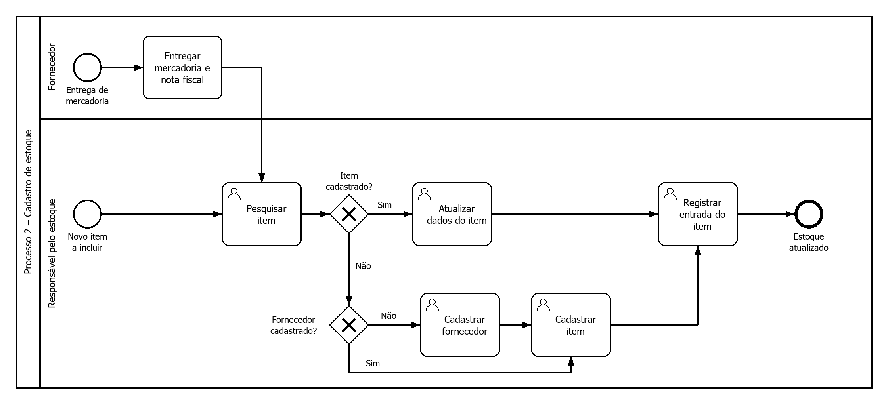
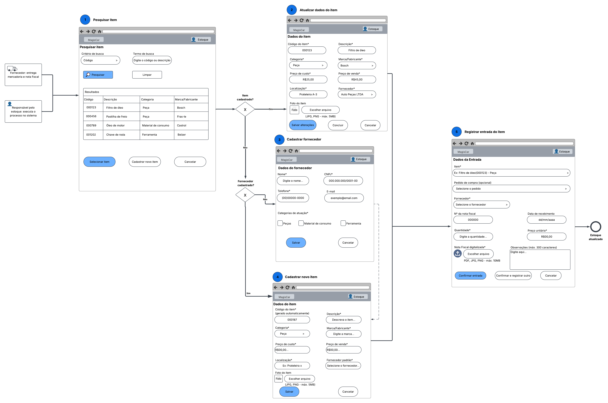

### 3.3.1 Processo 2 – Cadastro de estoque

O processo de cadastro de estoque é responsável por manter atualizado o registro das peças, materiais e ferramentas utilizados pela oficina mecânica, bem como dos fornecedores e das quantidades que entram no almoxarifado. Ele acontece no almoxarifado/estoque da oficina e é executado no sistema web pelo **Responsável pelo estoque**, com a participação do **Fornecedor**, que entrega as mercadorias e a nota fiscal com os dados utilizados no cadastro.

O processo começa quando uma mercadoria chega à oficina ou quando surge a necessidade de incluir um novo item no estoque, e é finalizado quando o item está cadastrado, com seus dados atualizados e a quantidade recebida registrada no saldo do estoque.

**Tarefas:**

1. **Pesquisar item:** o responsável pelo estoque pesquisa o item pelo código ou pela descrição para verificar se ele já está cadastrado;
2. **Cadastrar item:** se o item **não** estiver cadastrado, o responsável informa os dados do item (peça, material de consumo ou ferramenta), incluindo a quantidade mínima e o fornecedor padrão;
3. **Cadastrar fornecedor:** caso o fornecedor do item ainda não exista no sistema, o responsável cadastra o fornecedor e retorna ao cadastro do item (RF-010);
4. **Atualizar dados do item:** se o item já estiver cadastrado, o responsável confere os dados e, caso necessário, os atualiza (preço, localização, quantidade mínima, fornecedor padrão);
5. **Registrar entrada do item:** o responsável registra a entrada da mercadoria, informando o pedido de compra (quando houver), os dados da nota fiscal e a quantidade recebida (RF-009);
6. O sistema soma a quantidade recebida ao saldo do item e armazena o registro da entrada.

**Produtos do processo:** cadastro de itens, cadastro de fornecedores, registros de entrada e saldo atualizado do estoque.

##### 3.3.1.1 Modelagem BPMN

##### 3.3.1.2 Detalhamento das atividades do usuário (user tasks)

#### Detalhamento das atividades

**1. Pesquisar item**

| **Campo**          | **Tipo**        | **Restrições**                                          | **Valor default** |
| ---                | ---             | ---                                                     | ---               |
| Critério de busca  | Seleção única   | Código, Descrição                                       | Descrição         |
| Termo de busca     | Caixa de texto  | Obrigatório; mínimo de 3 caracteres                     |                   |
| Resultados         | Tabela          | Colunas: Código, Descrição, Categoria, Marca/Fabricante; somente leitura |  |

| **Comandos**        | **Destino**                                   | **Tipo**  |
| ---                 | ---                                           | ---       |
| Pesquisar           | Pesquisar item (exibe resultados)             | default   |
| Selecionar item     | Atualizar dados do item                       |           |
| Cadastrar novo item | Cadastrar item                                |           |
| Cancelar            | Fim do Processo 2                             | cancel    |

**2. Cadastrar item**

| **Campo**          | **Tipo**        | **Restrições**                                          | **Valor default** |
| ---                | ---             | ---                                                     | ---               |
| Código do item     | Caixa de texto  | Somente leitura; único no sistema                       | Gerado automaticamente |
| Descrição          | Caixa de texto  | Obrigatório; máximo de 100 caracteres                   |                   |
| Categoria          | Seleção única   | Obrigatório; Peça, Material de consumo, Ferramenta      | Peça              |
| Marca/Fabricante   | Caixa de texto  | Máximo de 50 caracteres                                 |                   |
| Preço de custo     | Número          | Maior ou igual a 0; duas casas decimais (R$)            | 0,00              |
| Preço de venda     | Número          | Maior ou igual ao preço de custo; duas casas decimais (R$) | 0,00           |
| Localização        | Caixa de texto  | Prateleira/corredor no almoxarifado                     |                   |
| Fornecedor padrão  | Seleção única   | Fornecedores cadastrados                                |                   |
| Foto do item       | Imagem          | Formatos JPG ou PNG; máximo de 5 MB                     |                   |

| **Comandos**         | **Destino**                                  | **Tipo**  |
| ---                  | ---                                          | ---       |
| Salvar               | Registrar entrada do item                    | default   |
| Cadastrar fornecedor | Cadastrar fornecedor                         |           |
| Cancelar             | Pesquisar item                               | cancel    |

**3. Cadastrar fornecedor**

| **Campo**          | **Tipo**        | **Restrições**                                          | **Valor default** |
| ---                | ---             | ---                                                     | ---               |
| Nome               | Caixa de texto  | Obrigatório; máximo de 100 caracteres                   |                   |
| CNPJ               | Caixa de texto  | Obrigatório; formato 00.000.000/0000-00; único no sistema |                 |
| Telefone           | Caixa de texto  | Obrigatório; formato (00) 00000-0000                    |                   |
| E-mail             | Caixa de texto  | Obrigatório; formato de e-mail                          |                   |
| Categorias fornecidas | Seleção múltipla | Peça, Material de consumo, Ferramenta                | Peça              |

| **Comandos**        | **Destino**                                   | **Tipo**  |
| ---                 | ---                                           | ---       |
| Salvar              | Cadastrar item                                | default   |
| Cancelar            | Cadastrar item                                | cancel    |

**4. Atualizar dados do item**

| **Campo**          | **Tipo**        | **Restrições**                                          | **Valor default** |
| ---                | ---             | ---                                                     | ---               |
| Código do item     | Caixa de texto  | Somente leitura                                         | Valor cadastrado  |
| Descrição          | Caixa de texto  | Obrigatório; máximo de 100 caracteres                   | Valor cadastrado  |
| Categoria          | Seleção única   | Obrigatório; Peça, Material de consumo, Ferramenta      | Valor cadastrado  |
| Marca/Fabricante   | Caixa de texto  | Máximo de 50 caracteres                                 | Valor cadastrado  |
| Preço de custo     | Número          | Maior ou igual a 0; duas casas decimais (R$)            | Valor cadastrado  |
| Preço de venda     | Número          | Maior ou igual ao preço de custo; duas casas decimais (R$) | Valor cadastrado |
| Localização        | Caixa de texto  | Prateleira/corredor no almoxarifado                     | Valor cadastrado  |
| Fornecedor padrão  | Seleção única   | Fornecedores cadastrados                                | Valor cadastrado  |
| Foto do item       | Imagem          | Formatos JPG ou PNG; máximo de 5 MB                     | Valor cadastrado  |

| **Comandos**        | **Destino**                                   | **Tipo**  |
| ---                 | ---                                           | ---       |
| Salvar alterações   | Registrar entrada do item                     | default   |
| Concluir            | Fim do Processo 2                             |           |
| Cancelar            | Pesquisar item                                | cancel    |

**5. Registrar entrada do item**

| **Campo**          | **Tipo**        | **Restrições**                                          | **Valor default** |
| ---                | ---             | ---                                                     | ---               |
| Item               | Caixa de texto  | Somente leitura                                         | Item cadastrado/selecionado |
| Pedido de compra   | Seleção única   | Pedidos em aberto do item; opcional para entradas sem pedido |              |
| Fornecedor         | Seleção única   | Obrigatório; fornecedores cadastrados                   | Fornecedor padrão do item |
| Número da nota fiscal | Caixa de texto | Obrigatório                                           |                   |
| Data de recebimento | Data           | Obrigatório; não pode ser data futura                   | Data atual        |
| Quantidade recebida | Número         | Obrigatório; maior que 0                                |                   |
| Preço unitário     | Número          | Maior ou igual a 0; duas casas decimais (R$)            | Preço de custo do item |
| Nota fiscal digitalizada | Arquivo   | Formatos PDF, JPG ou PNG; máximo de 10 MB               |                   |
| Observações        | Área de texto   | Máximo de 300 caracteres                                |                   |

| **Comandos**               | **Destino**                            | **Tipo**  |
| ---                        | ---                                    | ---       |
| Confirmar entrada          | Fim do Processo 2 (estoque atualizado) | default   |
| Confirmar e registrar outro | Pesquisar item                        |           |
| Cancelar                   | Pesquisar item                         | cancel    |

##### 3.3.1.3 Wireframes (user tasks)

