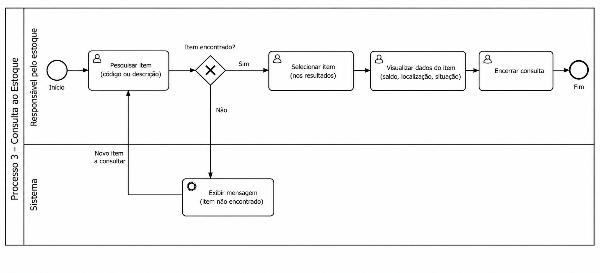
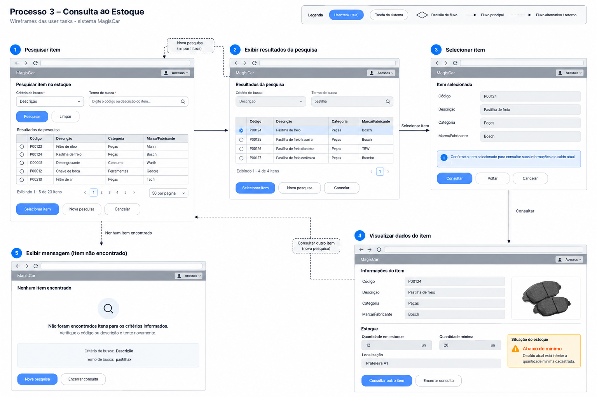

### 3.3.2 Processo 3 – Consulta ao Estoque

O processo de consulta ao estoque permite que o responsável pelo estoque consulte a disponibilidade de peças, materiais de consumo e ferramentas utilizados pela oficina mecânica. O processo é executado no sistema web pelo **Responsável pelo estoque** e utiliza os dados previamente cadastrados no Processo 2 – Cadastro de estoque.

O processo começa quando surge a necessidade de consultar um item e é finalizado quando o responsável visualiza as informações do item selecionado ou encerra a consulta após não encontrar o item desejado.

**Tarefas:**

1. **Pesquisar item:** o responsável pelo estoque pesquisa o item pelo código ou pela descrição;
2. **Exibir resultados da pesquisa:** o sistema apresenta os itens encontrados conforme os critérios informados;
3. **Selecionar item:** o responsável seleciona o item desejado na lista de resultados;
4. **Visualizar dados do item:** o sistema apresenta os dados cadastrais, o saldo atual, a localização e a situação do estoque;
5. **Exibir mensagem:** caso nenhum item seja encontrado, o sistema informa que não há resultados e permite realizar uma nova pesquisa.

**Produtos do processo:** resultado da pesquisa, informações cadastrais do item e visualização do saldo atual do estoque.

##### 3.3.2.1 Modelagem BPMN

##### 3.3.2.2 Detalhamento das atividades do usuário (user tasks)

#### Detalhamento das atividades

**Pesquisar item**

| **Campo** | **Tipo** | **Restrições** | **Valor default** |
| --- | --- | --- | --- |
| Critério de busca | Seleção única | Código, Descrição | Descrição |
| Termo de busca | Caixa de texto | Obrigatório; mínimo de 3 caracteres | |
| Resultados | Tabela | Colunas: Código, Descrição, Categoria, Marca/Fabricante; somente leitura | |

| **Comandos** | **Destino** | **Tipo** |
| --- | --- | --- |
| Pesquisar | Exibir resultados da pesquisa | default |
| Selecionar item | Selecionar item nos resultados | |
| Nova pesquisa | Pesquisar item | |
| Cancelar | Fim do Processo 3 | cancel |

**Exibir resultados da pesquisa**

| **Campo** | **Tipo** | **Restrições** | **Valor default** |
| --- | --- | --- | --- |
| Código do item | Texto | Somente leitura | Código cadastrado |
| Descrição | Texto | Somente leitura | Descrição cadastrada |
| Categoria | Texto | Somente leitura | Categoria cadastrada |
| Marca/Fabricante | Texto | Somente leitura; quando informado | Valor cadastrado |

| **Comandos** | **Destino** | **Tipo** |
| --- | --- | --- |
| Selecionar item | Selecionar item nos resultados | default |
| Nova pesquisa | Pesquisar item | |
| Cancelar | Fim do Processo 3 | cancel |

**Selecionar item**

O responsável seleciona um item na lista de resultados para consultar suas informações e o saldo atual do estoque.

| **Campo** | **Tipo** | **Restrições** | **Valor default** |
| --- | --- | --- | --- |
| Item selecionado | Seleção única | Obrigatório; deve corresponder a um item cadastrado | Nenhum |

| **Comandos** | **Destino** | **Tipo** |
| --- | --- | --- |
| Consultar | Visualizar dados do item | default |
| Voltar | Exibir resultados da pesquisa | |
| Cancelar | Fim do Processo 3 | cancel |

**Visualizar dados do item**

| **Campo** | **Tipo** | **Restrições** | **Valor default** |
| --- | --- | --- | --- |
| Código do item | Texto | Somente leitura | Código cadastrado |
| Descrição | Texto | Somente leitura | Descrição cadastrada |
| Categoria | Texto | Somente leitura | Categoria cadastrada |
| Marca/Fabricante | Texto | Somente leitura; quando informado | Valor cadastrado |
| Quantidade em estoque | Número | Somente leitura; saldo atual registrado no sistema | Saldo atual |
| Quantidade mínima | Número | Somente leitura | Quantidade mínima cadastrada |
| Localização | Texto | Somente leitura; quando informada | Localização cadastrada |
| Situação do estoque | Texto | Somente leitura; indica se o saldo está normal ou abaixo do mínimo | Calculada pelo sistema |

A situação do estoque deve ser apresentada como **Abaixo do mínimo** quando a quantidade disponível for inferior à quantidade mínima cadastrada. Caso contrário, deve ser apresentada como **Normal**.

| **Comandos** | **Destino** | **Tipo** |
| --- | --- | --- |
| Consultar outro item | Pesquisar item | |
| Encerrar consulta | Fim do Processo 3 | default |

**Exibir mensagem (item não encontrado)**

Esta atividade é executada pelo sistema quando a pesquisa não retorna nenhum item correspondente aos critérios informados.

| **Campo** | **Tipo** | **Restrições** | **Valor default** |
| --- | --- | --- | --- |
| Mensagem | Texto | Somente leitura; informar que nenhum item foi encontrado | Item não encontrado |

| **Comandos** | **Destino** | **Tipo** |
| --- | --- | --- |
| Nova pesquisa | Pesquisar item | default |
| Encerrar consulta | Fim do Processo 3 | cancel |

##### 3.3.2.3 Wireframes (user tasks)

