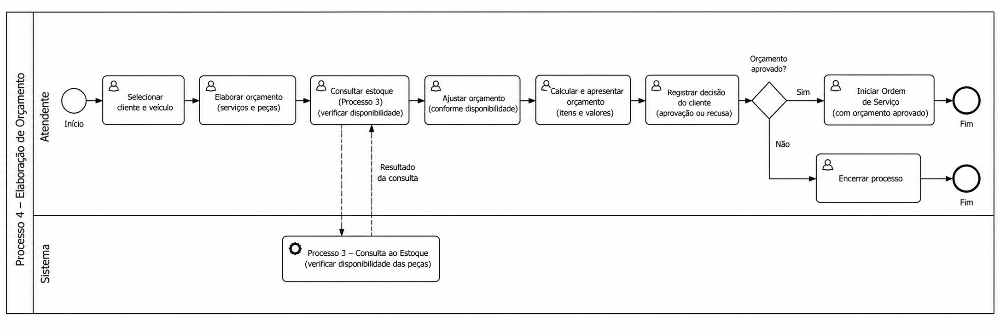
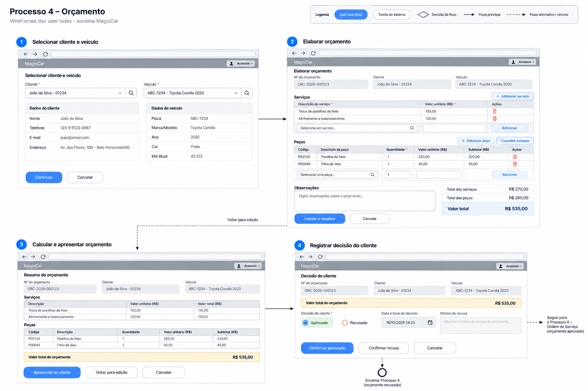

### 3.3.3 Processo 4 – Orçamento

O processo de elaboração de orçamento permite que a atendente registre os serviços e as peças necessários para o atendimento de um veículo, calcule o valor total e apresente a proposta ao cliente. O processo utiliza os dados cadastrados no Processo 1 – Cadastro de clientes/veículos, os itens registrados no Processo 2 – Cadastro de estoque e, quando necessário, as informações do Processo 3 – Consulta ao Estoque.

O processo começa quando o cliente solicita um orçamento para seu veículo. A atendente seleciona o cliente e o veículo cadastrados no Processo 1, registra os serviços e as peças necessários e apresenta o valor total ao cliente. O processo é finalizado quando o cliente aprova ou recusa o orçamento. Quando aprovado, o orçamento fica disponível para iniciar o Processo 6 – Ordem de Serviço, que será criado utilizando os dados do orçamento aprovado.

**Tarefas:**

1. **Selecionar cliente e veículo:** a atendente identifica o cliente e o veículo utilizando os cadastros existentes no Processo 1;
2. **Elaborar orçamento:** a atendente adiciona os serviços necessários e seleciona as peças cadastradas no estoque, consultando a disponibilidade quando necessário;
3. **Calcular e apresentar orçamento:** o sistema calcula automaticamente o valor total e apresenta os itens e valores para o cliente;
4. **Registrar decisão do cliente:** a atendente registra a aprovação ou recusa. Quando aprovado, o orçamento fica disponível para a abertura da ordem de serviço no Processo 6.

**Produtos do processo:** orçamento registrado com cliente, veículo, serviços, peças e valor total; decisão do cliente registrada; orçamento aprovado disponível para abertura de ordem de serviço.

##### 3.3.3.1 Modelagem BPMN

 ("Modelo BPMN do Processo 4.")

##### 3.3.3.2 Detalhamento das atividades do usuário (user tasks)

#### Detalhamento das atividades

**Selecionar cliente e veículo**

| **Campo** | **Tipo** | **Restrições** | **Valor default** |
| --- | --- | --- | --- |
| Cliente | Seleção única | Obrigatório; cliente cadastrado no Processo 1 | Nenhum |
| Veículo | Seleção única | Obrigatório; vinculado ao cliente selecionado | Nenhum |

| **Comandos** | **Destino** | **Tipo** |
| --- | --- | --- |
| Continuar | Elaborar orçamento | default |
| Cancelar | Fim do Processo 4 | cancel |

**Elaborar orçamento**

| **Campo** | **Tipo** | **Restrições** | **Valor default** |
| --- | --- | --- | --- |
| Número do orçamento | Texto | Somente leitura; gerado automaticamente | Gerado pelo sistema |
| Cliente | Texto | Somente leitura; cliente selecionado | Cliente selecionado |
| Veículo | Texto | Somente leitura; veículo vinculado ao cliente | Veículo selecionado |
| Serviços | Tabela editável | Obrigatório; deve conter pelo menos um serviço | Nenhum |
| Peças | Tabela editável | Opcional; itens cadastrados no Processo 2 | Nenhuma |
| Quantidade de peças | Número | Obrigatório para cada peça; maior que zero | 1 |
| Valor unitário da peça | Número decimal | Obrigatório; valor não negativo | Preço cadastrado |
| Valor dos serviços | Número decimal | Obrigatório; valor não negativo | Informado pela atendente |
| Valor total | Número decimal | Somente leitura; calculado automaticamente | Calculado pelo sistema |
| Observações | Caixa de texto | Opcional | Vazio |

| **Comandos** | **Destino** | **Tipo** |
| --- | --- | --- |
| Adicionar serviço | Elaborar orçamento | default |
| Adicionar peça | Elaborar orçamento | |
| Consultar estoque | Processo 3 – Consulta ao Estoque | |
| Calcular e visualizar | Calcular e apresentar orçamento | default |
| Cancelar | Fim do Processo 4 | cancel |

**Calcular e apresentar orçamento**

Esta atividade permite conferir os serviços, as peças e os valores calculados antes de apresentar o orçamento ao cliente.

| **Campo** | **Tipo** | **Restrições** | **Valor default** |
| --- | --- | --- | --- |
| Número do orçamento | Texto | Somente leitura | Gerado pelo sistema |
| Cliente | Texto | Somente leitura | Cliente selecionado |
| Veículo | Texto | Somente leitura | Veículo selecionado |
| Serviços | Tabela | Somente leitura; descrição e valor | Serviços registrados |
| Peças | Tabela | Somente leitura; descrição, quantidade e subtotal | Peças registradas |
| Valor total | Número decimal | Somente leitura; soma dos serviços e das peças | Calculado pelo sistema |

O valor total deve corresponder à soma dos valores dos serviços com os subtotais das peças. O subtotal de cada peça é calculado pela multiplicação da quantidade pelo valor unitário.

| **Comandos** | **Destino** | **Tipo** |
| --- | --- | --- |
| Apresentar ao cliente | Registrar decisão do cliente | default |
| Voltar para edição | Elaborar orçamento | |
| Cancelar | Fim do Processo 4 | cancel |

**Registrar decisão do cliente**

A atendente registra a decisão informada pelo cliente após a apresentação do orçamento.

| **Campo** | **Tipo** | **Restrições** | **Valor default** |
| --- | --- | --- | --- |
| Número do orçamento | Texto | Somente leitura | Orçamento atual |
| Valor total | Número decimal | Somente leitura | Total calculado |
| Decisão do cliente | Seleção única | Obrigatório; Aprovado ou Recusado | Nenhuma |
| Data da decisão | Data e hora | Preenchida automaticamente pelo sistema | Data e hora atuais |
| Motivo da recusa | Caixa de texto | Obrigatório quando a decisão for Recusado | Vazio |

| **Comandos** | **Destino** | **Tipo** |
| --- | --- | --- |
| Confirmar aprovação | Iniciar Processo 6 – Ordem de Serviço com o orçamento aprovado | default |
| Confirmar recusa | Fim do Processo 4 | cancel |

##### 3.3.3.3 Wireframes (user tasks)

