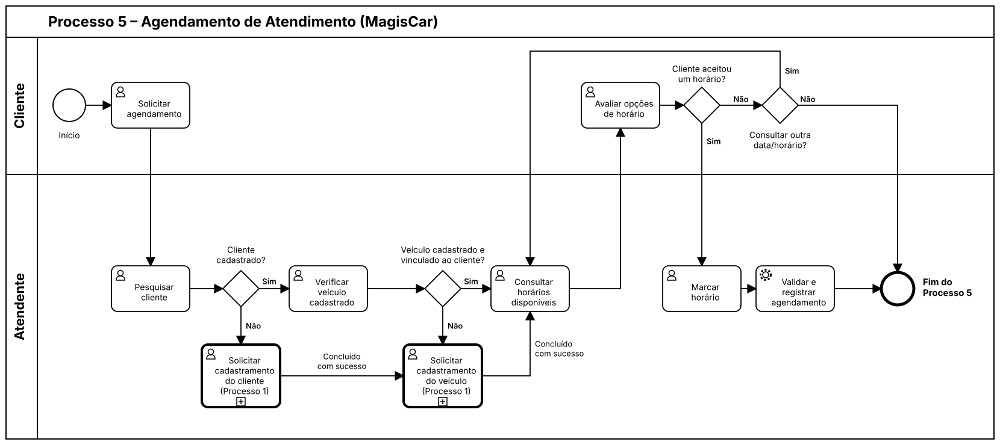
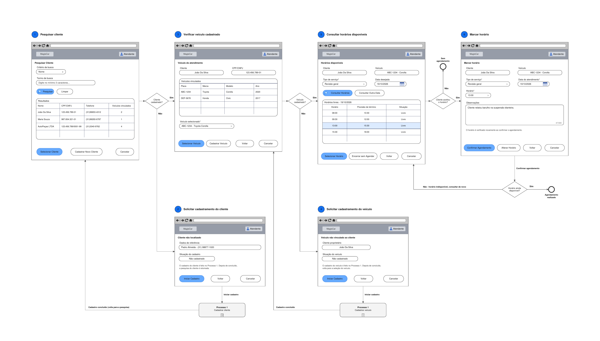

### 3.3.1 Processo 5 – Agendamento de Atendimento

O processo de agendamento de atendimento é um processo principal do sistema MagisCar e permite que o **Atendente**, mediante a solicitação do **Cliente**, consulte horários disponíveis e registre uma data e um horário para revisão, manutenção ou outro atendimento do veículo na oficina.

O processo começa quando um cliente solicita um atendimento para seu veículo, presencialmente ou por telefone/mensagem. O atendente pesquisa o cadastro no sistema e verifica se o cliente e o veículo estão cadastrados. Quando faltar algum cadastro, o atendimento é encaminhado ao **Processo 1 – Cadastro de clientes/veículos**; depois da conclusão do cadastro, o agendamento pode ser retomado. Quando o cliente não está cadastrado, o cadastro do veículo é solicitado em seguida. O processo termina com o **agendamento realizado** ou **sem agendamento** (quando não for possível chegar a um horário aceito).

**Tarefas:**

1. **Pesquisar cliente:** o atendente pesquisa o cliente por nome, CPF/CNPJ, telefone ou placa do veículo (RF-003);
2. **Solicitar cadastramento do cliente:** se o cliente não for encontrado, o atendente encaminha seu cadastro ao Processo 1 e, após a conclusão, segue para o cadastramento do veículo;
3. **Verificar veículo cadastrado:** com o cliente identificado, o atendente consulta os veículos vinculados e seleciona o que receberá atendimento;
4. **Solicitar cadastramento do veículo:** caso o veículo não esteja vinculado ao cliente, o atendente encaminha o cadastro ao Processo 1 e, após a conclusão, segue para a consulta de horários;
5. **Consultar horários disponíveis:** o atendente consulta as datas e os horários livres para o serviço desejado, apresenta as opções ao cliente e, caso necessário, pesquisa outras datas;
6. **Marcar horário:** quando o cliente aceita uma opção disponível, o atendente confirma os dados e registra o agendamento no sistema.

**Produtos do processo:** consulta de horários disponíveis; agendamento de atendimento registrado com cliente, veículo, serviço, data e horário; ou encerramento sem agendamento, conforme o caso.

##### 3.3.1.1 Modelagem BPMN

##### 3.3.1.2 Detalhamento das atividades do usuário (user tasks)

#### Detalhamento das atividades

**Pesquisar cliente**

| **Campo** | **Tipo** | **Restrições** | **Valor default** |
| --- | --- | --- | --- |
| Critério de busca | Seleção única | Nome, CPF/CNPJ, Telefone, Placa do veículo | Nome |
| Termo de busca | Caixa de texto | Obrigatório; mínimo de 3 caracteres | |
| Resultados | Tabela | Colunas: Nome, CPF/CNPJ, Telefone, Veículos vinculados; somente leitura | |

| **Comandos** | **Destino** | **Tipo** |
| --- | --- | --- |
| Pesquisar | Pesquisar cliente (exibe resultados) | default |
| Selecionar cliente | Verificar veículo cadastrado | |
| Cadastrar novo cliente | Solicitar cadastramento do cliente | |

**Solicitar cadastramento do cliente**

| **Campo** | **Tipo** | **Restrições** | **Valor default** |
| --- | --- | --- | --- |
| Dados de referência | Caixa de texto | Nome, telefone ou identificação informada pelo cliente; apenas para encaminhamento | Dados disponíveis da pesquisa |
| Situação do cadastro | Informação | Indica que o cliente não foi localizado; somente leitura | Não cadastrado |

| **Comandos** | **Destino** | **Tipo** |
| --- | --- | --- |
| Iniciar cadastro | Processo 1 – Cadastrar cliente; após conclusão, seguir para Solicitar cadastramento do veículo | default |
| Voltar | Pesquisar cliente | |

**Verificar veículo cadastrado**

| **Campo** | **Tipo** | **Restrições** | **Valor default** |
| --- | --- | --- | --- |
| Cliente | Caixa de texto | Somente leitura; cliente identificado na pesquisa | Cliente selecionado |
| CPF/CNPJ | Caixa de texto | Somente leitura; valor registrado no cadastro | Valor cadastrado |
| Veículos vinculados | Tabela | Colunas: Placa, Marca, Modelo, Ano; somente leitura | Veículos do cliente |
| Veículo selecionado | Seleção única | Obrigatório para prosseguir; apenas veículos vinculados ao cliente | |

| **Comandos** | **Destino** | **Tipo** |
| --- | --- | --- |
| Selecionar veículo | Consultar horários disponíveis | default |
| Cadastrar veículo | Solicitar cadastramento do veículo | |
| Voltar | Pesquisar cliente | |

**Solicitar cadastramento do veículo**

| **Campo** | **Tipo** | **Restrições** | **Valor default** |
| --- | --- | --- | --- |
| Cliente proprietário | Caixa de texto | Somente leitura; vínculo obrigatório com o cliente cadastrado | Cliente selecionado |
| Situação do veículo | Informação | Indica que o veículo não foi encontrado entre os veículos vinculados; somente leitura | Não cadastrado |

| **Comandos** | **Destino** | **Tipo** |
| --- | --- | --- |
| Iniciar cadastro | Processo 1 – Cadastrar veículo; após conclusão, seguir para Consultar horários disponíveis | default |
| Voltar | Verificar veículo cadastrado | |

**Consultar horários disponíveis**

| **Campo** | **Tipo** | **Restrições** | **Valor default** |
| --- | --- | --- | --- |
| Cliente | Caixa de texto | Somente leitura; cliente selecionado | Cliente selecionado |
| Veículo | Caixa de texto | Somente leitura; veículo vinculado ao cliente | Veículo selecionado |
| Tipo de serviço | Seleção única | Obrigatório; serviços oferecidos pela oficina | |
| Data desejada | Data | Não pode ser anterior à data atual | Data atual |
| Horários disponíveis | Tabela | Exibir somente horários livres para a data e o serviço consultados | |

| **Comandos** | **Destino** | **Tipo** |
| --- | --- | --- |
| Consultar horários | Consultar horários disponíveis (atualiza resultados) | default |
| Selecionar horário | Marcar horário | |
| Consultar outra data | Consultar horários disponíveis | |
| Encerrar sem agendar | Fim do Processo 5 (sem agendamento) | |
| Voltar | Verificar veículo cadastrado | |

**Marcar horário**

| **Campo** | **Tipo** | **Restrições** | **Valor default** |
| --- | --- | --- | --- |
| Cliente | Caixa de texto | Somente leitura; cliente cadastrado | Cliente selecionado |
| Veículo | Caixa de texto | Somente leitura; veículo vinculado ao cliente | Veículo selecionado |
| Tipo de serviço | Seleção única | Obrigatório; serviço previamente escolhido | Serviço selecionado |
| Data do atendimento | Data | Obrigatória; não pode ser anterior à data atual | Data escolhida |
| Horário | Seleção única | Obrigatório; precisa continuar disponível no momento da confirmação | Horário selecionado |
| Observações | Área de texto | Opcional; máximo de 300 caracteres | |

| **Comandos** | **Destino** | **Tipo** |
| --- | --- | --- |
| Confirmar agendamento | Fim do Processo 5 (agendamento realizado), após validação e gravação | default |
| Alterar horário | Consultar horários disponíveis | |
| Voltar | Consultar horários disponíveis | |

3.3.1.3 Wireframes (user tasks)  

