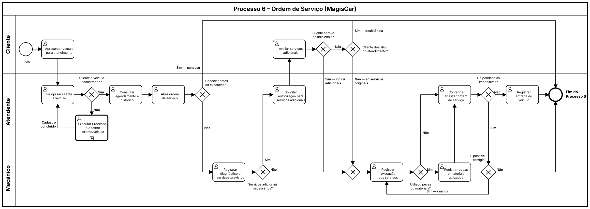
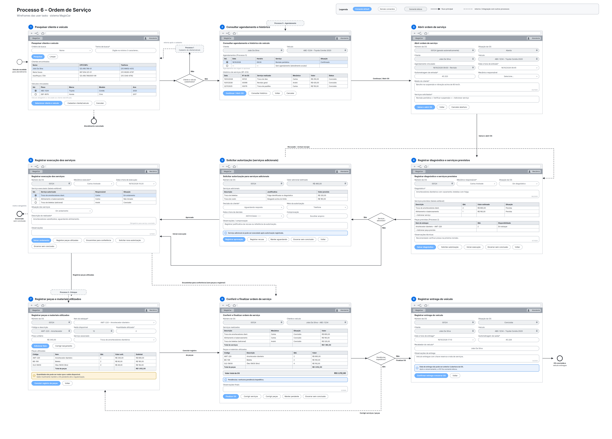

### 3.3.1 Processo 6 – Ordem de Serviço

O processo de ordem de serviço é um processo principal do sistema **MagisCar** e permite registrar, acompanhar e concluir os serviços executados nos veículos atendidos pela oficina mecânica. Ele é iniciado quando o **Cliente** apresenta o veículo para atendimento e é conduzido pelo **Atendente**, que identifica o cliente e o veículo e abre a ordem de serviço (OS), com participação do **Mecânico**, responsável por registrar a execução dos serviços e as peças utilizadas, e do **Cliente**, quando houver necessidade de autorizar serviços adicionais.

O processo começa quando o veículo é recebido para atendimento, com ou sem agendamento prévio. O atendente utiliza os cadastros existentes no **Processo 1 – Cadastro de clientes/veículos** e, quando houver, consulta o agendamento registrado no **Processo 5 – Agendamento de Atendimento**. Durante a execução, as peças consumidas são relacionadas ao cadastro de itens e aos saldos mantidos pelo **Processo 2 – Cadastro de estoque**. O processo possui um único fim, que ocorre quando a OS é **concluída e o veículo é liberado**, quando a OS é **cancelada antes da execução**, ou quando o atendimento é **encerrado sem conclusão do serviço**, com registro do motivo.

**Tarefas:**

1. **Pesquisar cliente e veículo:** o atendente localiza o cliente por nome, CPF/CNPJ, telefone ou placa, seleciona o veículo vinculado e, se necessário, encaminha a regularização do cadastro ao Processo 1;
2. **Consultar agendamento e histórico do veículo:** o atendente verifica se há agendamento associado no Processo 5 e consulta o histórico de serviços do veículo disponibilizado pelo Processo 1 (RF-013);
3. **Abrir ordem de serviço:** o atendente registra os dados da OS, a queixa relatada pelo cliente, a quilometragem, a data de entrada, os serviços solicitados e o responsável, quando definido; antes da execução, a OS ainda pode ser cancelada;
4. **Registrar diagnóstico e serviços previstos:** o mecânico registra os problemas identificados, os serviços necessários e a previsão de peças ou materiais, atualizando a situação da OS;
5. **Solicitar autorização para serviços adicionais:** quando forem identificados serviços não previstos ou valores adicionais, o atendente apresenta a proposta ao cliente e registra sua decisão antes de autorizar a execução correspondente; se o cliente recusar, a execução segue apenas com os serviços originais ou o atendimento é cancelado por desistência;
6. **Registrar execução dos serviços:** o mecânico informa serviços realizados, responsável, observações e andamento, mantendo o histórico de execução da OS;
7. **Registrar peças e materiais utilizados:** quando houver uso de peças ou materiais, o mecânico ou responsável autorizado seleciona itens do estoque, informa quantidades e registra a utilização na OS, com conferência de disponibilidade e atualização do saldo;
8. **Conferir e finalizar ordem de serviço:** o atendente confere os serviços e materiais registrados, os valores e a situação do veículo; se houver pendências, devolve a OS para correção ou, não sendo possível corrigir, encerra o atendimento sem conclusão;
9. **Registrar entrega do veículo:** após a conclusão, o atendente registra a liberação/entrega do veículo ao cliente e encerra a OS.

**Produtos do processo:** OS numerada e vinculada ao cliente e ao veículo; histórico de diagnóstico, serviços e responsáveis; registro de peças e materiais utilizados; valores consolidados; situação da OS; atualização do histórico do veículo e do saldo dos itens consumidos; encerramento por conclusão, cancelamento ou impossibilidade de concluir o atendimento.

##### 3.3.1.1 Modelagem BPMN

##### 3.3.1.2 Detalhamento das atividades do usuário (user tasks)

#### Detalhamento das atividades

**Pesquisar cliente e veículo**

| **Campo** | **Tipo** | **Restrições** | **Valor default** |
| --- | --- | --- | --- |
| Critério de busca | Seleção única | Nome, CPF/CNPJ, Telefone, Placa do veículo | Nome |
| Termo de busca | Caixa de texto | Obrigatório; mínimo de 3 caracteres | |
| Clientes encontrados | Tabela | Colunas: Nome, CPF/CNPJ, Telefone; somente leitura | |
| Veículos vinculados | Tabela | Colunas: Placa, Marca, Modelo, Ano; somente leitura | Veículos do cliente selecionado |
| Veículo selecionado | Seleção única | Obrigatório; vinculado ao cliente identificado | |

| **Comandos** | **Destino** | **Tipo** |
| --- | --- | --- |
| Pesquisar | Pesquisar cliente e veículo (exibe resultados) | default |
| Selecionar cliente e veículo | Consultar agendamento e histórico do veículo | |
| Cadastrar cliente/veículo | Processo 1; depois retornar a Pesquisar cliente e veículo | |

**Consultar agendamento e histórico do veículo**

| **Campo** | **Tipo** | **Restrições** | **Valor default** |
| --- | --- | --- | --- |
| Cliente | Caixa de texto | Somente leitura | Cliente selecionado |
| Veículo | Caixa de texto | Somente leitura | Veículo selecionado |
| Agendamentos | Tabela | Data, horário, serviço e situação; pode estar vazia | Agendamentos do veículo |
| Histórico de serviços | Tabela | Data, Nº da OS, Serviço realizado, Mecânico, Valor e Status; somente leitura (RF-013) | Histórico do veículo |
| Agendamento de origem | Seleção única | Opcional; somente agendamentos vinculados ao cliente/veículo | Sem agendamento |

| **Comandos** | **Destino** | **Tipo** |
| --- | --- | --- |
| Continuar / Abrir OS | Abrir ordem de serviço | default |
| Consultar histórico | Consultar agendamento e histórico do veículo | |
| Voltar | Pesquisar cliente e veículo | |

**Abrir ordem de serviço**

| **Campo** | **Tipo** | **Restrições** | **Valor default** |
| --- | --- | --- | --- |
| Número da OS | Caixa de texto | Único no sistema; gerado automaticamente; somente leitura | Gerado automaticamente |
| Cliente | Caixa de texto | Somente leitura; cliente cadastrado | Cliente selecionado |
| Veículo | Caixa de texto | Somente leitura; veículo vinculado ao cliente | Veículo selecionado |
| Agendamento vinculado | Caixa de texto | Opcional; somente leitura quando selecionado | Agendamento de origem |
| Data e hora de entrada | Data e hora | Obrigatórias; não posteriores ao registro | Data e hora atuais |
| Quilometragem de entrada | Número | Obrigatório; maior ou igual a 0 | Quilometragem registrada, se houver |
| Relato do cliente | Área de texto | Obrigatório; máximo de 1.000 caracteres | |
| Serviços solicitados | Seleção múltipla / Área de texto | Obrigatório informar ao menos um serviço ou descrição | Serviços do agendamento, se houver |
| Mecânico responsável | Seleção única | Profissionais cadastrados; pode ser definido posteriormente | |
| Situação da OS | Informação | Somente leitura na abertura | Aberta |

| **Comandos** | **Destino** | **Tipo** |
| --- | --- | --- |
| Salvar e abrir OS | Registrar diagnóstico e serviços previstos | default |
| Voltar | Consultar agendamento e histórico do veículo | |
| Cancelar abertura | Fim do Processo 6 (atendimento cancelado) | cancel |

**Registrar diagnóstico e serviços previstos**

| **Campo** | **Tipo** | **Restrições** | **Valor default** |
| --- | --- | --- | --- |
| Número da OS | Caixa de texto | Somente leitura | OS atual |
| Mecânico responsável | Seleção única | Obrigatório para assumir a execução | Mecânico atribuído |
| Diagnóstico | Área de texto | Obrigatório antes de concluir avaliação; máximo de 2.000 caracteres | |
| Serviços previstos | Tabela editável | Descrição, quantidade/unidade quando aplicável, valor estimado e situação | Serviços solicitados |
| Peças previstas | Tabela editável | Itens do estoque; quantidades maiores que 0 | |
| Observações técnicas | Área de texto | Opcional; máximo de 1.000 caracteres | |
| Situação da OS | Seleção única | Aberta, Em diagnóstico, Aguardando autorização, Em execução | Em diagnóstico |

| **Comandos** | **Destino** | **Tipo** |
| --- | --- | --- |
| Salvar diagnóstico | Registrar diagnóstico e serviços previstos (atualiza dados) | default |
| Solicitar autorização | Solicitar autorização para serviços adicionais | |
| Iniciar execução | Registrar execução dos serviços (se não houver autorização pendente) | |
| Voltar | Abrir ordem de serviço (consulta/edição permitida) | |

**Solicitar autorização para serviços adicionais**

| **Campo** | **Tipo** | **Restrições** | **Valor default** |
| --- | --- | --- | --- |
| Número da OS | Caixa de texto | Somente leitura | OS atual |
| Serviços adicionais | Tabela | Descrição, justificativa, valor previsto; somente leitura após envio | Itens apontados no diagnóstico |
| Valor adicional estimado | Número | Calculado a partir dos serviços/itens adicionais; duas casas decimais (R$) | 0,00 |
| Decisão do cliente | Seleção única | Aprovado, Recusado, Aguardando resposta | Aguardando resposta |
| Data e hora da decisão | Data e hora | Obrigatórias quando houver decisão | |
| Meio da autorização | Seleção única | Presencial, Telefone, Mensagem, Outro | |
| Observações / comprovação | Área de texto / Arquivo | Informar justificativa da recusa ou referência da autorização, quando aplicável | |

| **Comandos** | **Destino** | **Tipo** |
| --- | --- | --- |
| Registrar aprovação | Registrar execução dos serviços | default |
| Registrar recusa | Registrar execução dos serviços (somente serviços originais) | |
| Registrar desistência | Fim do Processo 6 (atendimento cancelado; motivo obrigatório) | |
| Manter aguardando | Solicitar autorização para serviços adicionais (OS pendente) | |
| Voltar | Registrar diagnóstico e serviços previstos | cancel |

**Registrar execução dos serviços**

| **Campo** | **Tipo** | **Restrições** | **Valor default** |
| --- | --- | --- | --- |
| Número da OS | Caixa de texto | Somente leitura | OS atual |
| Serviço executado | Tabela editável | Selecionar serviço autorizado; descrição e situação | Serviços previstos/autorizados |
| Mecânico executor | Seleção única | Obrigatório; profissional cadastrado | Mecânico responsável |
| Data e hora de execução | Data e hora | Data/hora do registro ou efetiva execução | Data e hora atuais |
| Descrição do realizado | Área de texto | Obrigatório para serviço marcado como concluído | |
| Situação dos serviços | Seleção única | Não iniciado, Em andamento, Concluído, Impedido | Em andamento |
| Observações | Área de texto | Opcional; máximo de 1.000 caracteres | |

| **Comandos** | **Destino** | **Tipo** |
| --- | --- | --- |
| Salvar andamento | Registrar execução dos serviços (atualiza dados) | default |
| Registrar peças utilizadas | Registrar peças e materiais utilizados | |
| Encaminhar para conferência | Conferir e finalizar ordem de serviço | |

**Registrar peças e materiais utilizados**

| **Campo** | **Tipo** | **Restrições** | **Valor default** |
| --- | --- | --- | --- |
| Número da OS | Caixa de texto | Somente leitura | OS atual |
| Item do estoque | Seleção única | Apenas itens cadastrados no Processo 2 | |
| Código e descrição | Caixa de texto | Somente leitura | Item selecionado |
| Saldo disponível | Número | Somente leitura; consultar estoque atualizado | Saldo do item |
| Quantidade utilizada | Número | Obrigatório; maior que 0 e não superior ao saldo disponível | |
| Preço unitário | Número | Valor adotado no registro; duas casas decimais (R$) | Preço cadastrado do item |
| Serviço associado | Seleção única | Opcional; serviço registrado na OS | |
| Peças utilizadas | Tabela | Item, quantidade, valor unitário, subtotal; somente leitura dos registros salvos | |

| **Comandos** | **Destino** | **Tipo** |
| --- | --- | --- |
| Adicionar item | Registrar peças e materiais utilizados (grava uso e atualiza saldo) | default |
| Corrigir lançamento | Registrar peças e materiais utilizados (ajustar lançamento e saldo de forma rastreável) | |
| Concluir registro de peças | Conferir e finalizar ordem de serviço | |
| Voltar | Registrar execução dos serviços | cancel |

**Regra de estoque:** um item não pode ter a mesma quantidade baixada duas vezes pelo mesmo lançamento. Caso o saldo seja insuficiente, não registrar a utilização e manter a OS pendente até a regularização ou revisão do serviço. O **Processo 2** trata do cadastro e da entrada dos itens; a **baixa/consumo por OS** é feita neste processo.

**Conferir e finalizar ordem de serviço**

| **Campo** | **Tipo** | **Restrições** | **Valor default** |
| --- | --- | --- | --- |
| Número da OS | Caixa de texto | Somente leitura | OS atual |
| Cliente e veículo | Caixa de texto | Somente leitura | Cadastro vinculado |
| Serviços realizados | Tabela | Descrição, mecânico, situação, valor; somente leitura | Registros da execução |
| Peças e materiais utilizados | Tabela | Código, descrição, quantidade, valor; somente leitura | Consumo registrado |
| Total de serviços | Número | Calculado a partir dos serviços aprovados e executados; duas casas decimais (R$) | Calculado |
| Total de peças | Número | Calculado a partir do consumo registrado; duas casas decimais (R$) | Calculado |
| Valor total | Número | Soma de serviços e peças; duas casas decimais (R$) | Calculado |
| Pendências | Tabela / Informação | Listar serviços não concluídos, itens pendentes ou autorizações ausentes | |
| Observações finais | Área de texto | Opcional; máximo de 1.000 caracteres | |

| **Comandos** | **Destino** | **Tipo** |
| --- | --- | --- |
| Finalizar OS | Registrar entrega do veículo (somente se não houver pendências impeditivas) | default |
| Corrigir serviços | Registrar execução dos serviços | |
| Manter pendente | Conferir e finalizar ordem de serviço (sem encerrar) | |
| Encerrar sem conclusão | Fim do Processo 6 (encerrado sem conclusão; motivo obrigatório) | |

**Registrar entrega do veículo**

| **Campo** | **Tipo** | **Restrições** | **Valor default** |
| --- | --- | --- | --- |
| Número da OS | Caixa de texto | Somente leitura | OS atual |
| Cliente | Caixa de texto | Somente leitura | Cliente selecionado |
| Veículo | Caixa de texto | Somente leitura | Veículo selecionado |
| Data e hora de entrega | Data e hora | Obrigatórias; não anteriores à abertura da OS | Data e hora atuais |
| Quilometragem de saída | Número | Maior ou igual a 0 | Quilometragem de entrada |
| Recebedor do veículo | Caixa de texto | Obrigatório; máximo de 100 caracteres | Cliente cadastrado |
| Observações de entrega | Área de texto | Opcional; máximo de 500 caracteres | |
| Situação da OS | Informação | Somente leitura após encerramento | Concluída |

| **Comandos** | **Destino** | **Tipo** |
| --- | --- | --- |
| Confirmar entrega e encerrar OS | Fim do Processo 6 (OS concluída e veículo entregue) | default |
| Voltar | Conferir e finalizar ordem de serviço | cancel |

**Regras de negócio:**

- A OS deve ter identificador único e vínculo obrigatório com um cliente e um veículo já cadastrados (Processo 1).
- A existência de agendamento (Processo 5) é opcional: atendimentos não agendados também podem gerar OS.
- Os serviços adicionais devem ser autorizados antes da execução correspondente; o registro da decisão deve permanecer associado à OS.
- Consumos de peças devem referenciar itens existentes no Processo 2, respeitar disponibilidade e produzir movimentação rastreável do estoque.
- A OS só pode ser concluída após conferência das atividades e resolução de pendências impeditivas.
- Cancelamento, encerramento sem conclusão e conclusão normal são situações distintas; registrar responsável, data e motivo quando pertinente.
- O lançamento de pagamento e a emissão de documento fiscal não fazem parte deste Processo 6; o orçamento é tratado no **Processo 4 – Orçamento**.

##### 3.3.1.3 Wireframes (user tasks)

